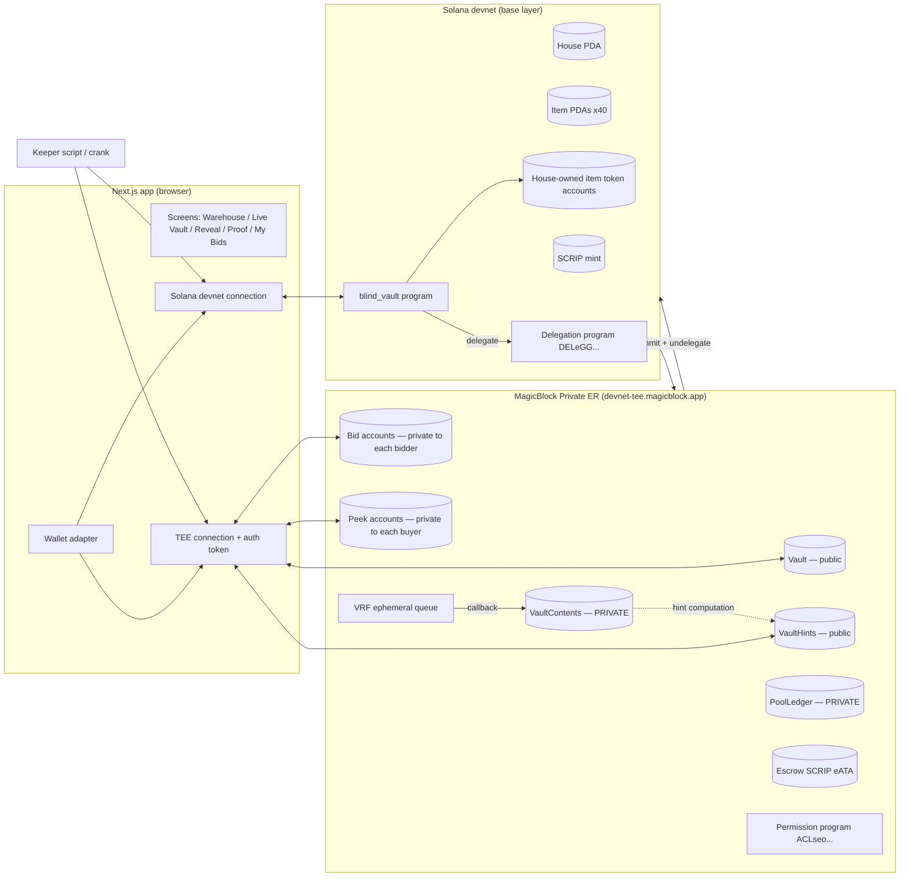
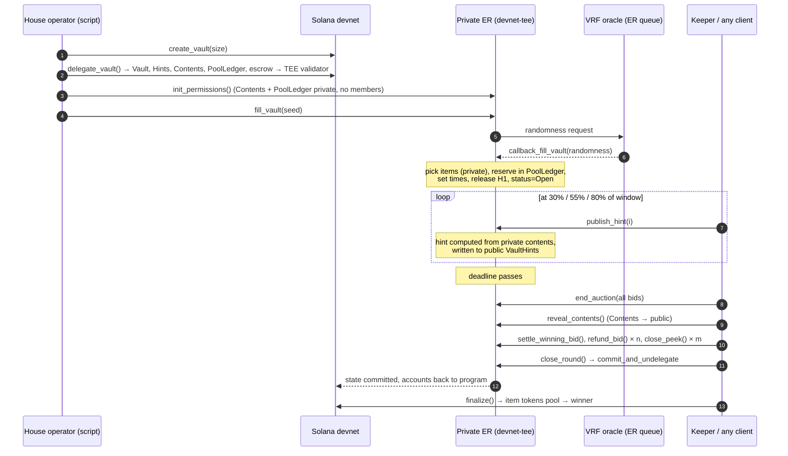
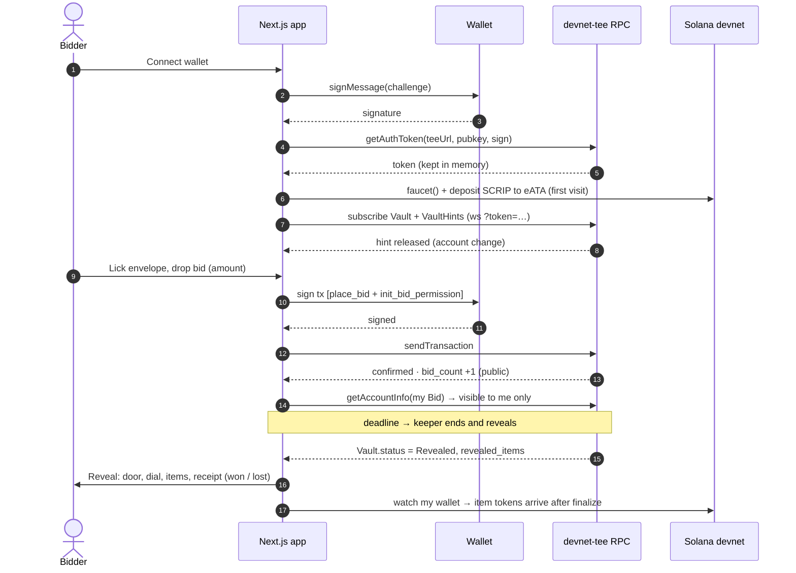
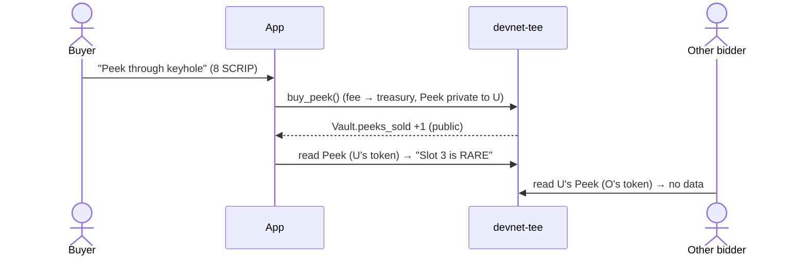

# Blind Vault — Build Spec

**Storage Wars on Solana.** Nobody, not even the house, knows what's in the vault. VRF fills it inside a Private Ephemeral Rollup, hints come out on a schedule, every bid stays sealed, and the highest bid opens it.

Hackathon: MagicBlock **Solana Blitz v10** (20–27 Nov 2026, online). Builder: Aditya Nishad (solo).
Spec version: 1.0, written 19 Nov 2026 (IST). All times are IST (UTC+5:30) unless marked.

> **How to read this.** Anything tagged **(verify)** is MagicBlock behaviour I couldn't confirm from the docs or the example code. Check it during the Day 1 spike before building on it. Anything tagged **UNKNOWN** wasn't published anywhere I could find. Don't assume it.

---

## Table of contents

1. [Overview and pitch](#1-overview-and-pitch)
2. [Hackathon facts](#2-hackathon-facts)
3. [Why MagicBlock is essential](#3-why-magicblock-is-essential)
4. [Feature list: MVP and stretch](#4-feature-list-mvp-and-stretch)
5. [Game rules and economy](#5-game-rules-and-economy)
6. [System architecture](#6-system-architecture)
7. [Anchor program](#7-anchor-program)
8. [Sequence diagrams](#8-sequence-diagrams)
9. [Frontend architecture](#9-frontend-architecture)
10. [Repo structure, scripts and testing](#10-repo-structure-scripts-and-testing)
11. [UI/UX: "Rocco's Lock-Up Auctions"](#11-uiux-roccos-lock-up-auctions)
12. [Demo script (under 3 minutes)](#12-demo-script-under-3-minutes)
13. [Day-by-day plan, 19–27 Nov (IST)](#13-day-by-day-plan-1927-nov-ist)
14. [Risks and fallbacks](#14-risks-and-fallbacks)
15. [Submission checklist](#15-submission-checklist)
16. [Judge Q&A](#16-judge-qa)
17. [Sources](#17-sources)

---

## 1. Overview and pitch

### One-liner
> Storage Wars on Solana: a sealed vault of collectibles that nobody, the house included, can see inside. Hints leak out over time, bids stay sealed, and the highest bid cracks it open.

### The 30-second pitch
Mystery boxes and loot crates have a trust problem. The operator picks what goes in and can stack the odds, and on a public chain everyone can read the contents and the bids anyway, so there's no real mystery. Blind Vault fixes both:

- **VRF fills the vault** from a public warehouse of items, so the house doesn't pick the contents.
- **The contents and the bids live in a Private Ephemeral Rollup** (a TEE). Nobody can read them until the vault opens, including the house, other bidders and RPC snoopers.
- **The program computes the hints on-chain** from the hidden contents, so a hint can't lie.
- **At the deadline the highest sealed bid wins.** The vault opens, the contents become public, and the winner gets the items as real SPL tokens in their wallet.

The fun is in the gamble: you read the hints, estimate the value, bid blind, and find out whether you overpaid.

### Theme fit: Entertainment Finance
The Luma page defines Entertainment Finance as "apps where you trade, collect, compete and win assets you actually own, with game mechanics on top."

| Entertainment Finance element | Blind Vault |
|---|---|
| Trade | Sealed-bid auctions and price discovery under uncertainty |
| Collect | Collectibles across 5 rarity tiers and 5 categories, held as SPL tokens |
| Compete | Bidders compete against each other; the hints reward reading the situation well |
| Win assets you own | The winner gets the item tokens in their wallet, not a database entry |
| Game mechanics on top | Timed hint drops, a countdown, the vault-opening reveal, a profit/loss receipt |

It is also MagicBlock's own **Idea 5: "Storage wars"** from the launch thread, with a twist that makes privacy essential: the *contents* are sealed too, not just the bids.

### What makes it different from existing projects
Plain sealed-bid auctions on MagicBlock already exist: Veil, GhostAuction, SealBid, GhostMarket, and MagicBlock's own Sealed-Bid Auction template. They hide the **bids**. Blind Vault also hides the **lot**, and adds two mechanics they don't have:
1. **Contents chosen by VRF with hidden assignment.** The item pool is public, but which items are in which vault is private.
2. **Hints proven on-chain.** The program derives each hint from the private state, so hints are trustworthy without revealing the state.

---

## 2. Hackathon facts

| Item | Value | Source |
|---|---|---|
| Event | Solana Blitz v10, by MagicBlock | [Luma](https://luma.com/hedv5sgh) |
| Theme | Entertainment Finance | Luma, [thread](https://x.com/magicblock/status/2123416305319673858) |
| Format | Online, one full week | Luma |
| Build window | Fri 20 Nov – Fri 27 Nov 2026 | [Timeline post](https://x.com/i/status/2123416423989207140) |
| Kickoff livestream | Fri 20 Nov, 10 PM Singapore = **7:30 PM IST** | Luma |
| Event end on Luma | 27 Nov, 14:00 UTC = **7:30 PM IST** | Luma event data |
| Exact submission deadline | "by Friday, Nov 27". The time is **UNKNOWN**; assume 7:30 PM IST and submit on the 26th | Timeline post |
| Prizes ($1,000 USDC total) | 1st $500, 2nd $250, 3rd $150, Wizardio's Choice $100 | Luma |
| The one requirement | Integrate Ephemeral Rollups, Private Ephemeral Rollups, or MagicBlock VRF | Timeline post |
| Judging criteria | **UNKNOWN** | — |
| Code written before the event | Rules **UNKNOWN**. In practice a 3-year-old project (Alerith) placed 3rd in v8 | [v8 recap](https://stacksmith.xyz/articles/magicblock-blitz-v8-winners) |
| Team size | **UNKNOWN**; solo entries are clearly welcome ("show up solo") | Luma |
| Support | Telegram builders group (unlocked by completing your builder profile); MagicBlock engineers active all week | Luma |
| Where to submit | https://build.magicblock.app/?stage=blitz#submit (it said "No open events" on 19 Nov) | Submit page |

**Submission form fields** (read from the form on 19 Nov):
- First and last name, email, country, role(s)
- **Wallet** (required; prizes are paid here)
- Project name, description, categories (up to 3: DeFi, Payments, Games, AI/Agents, Privacy, Infra, DePIN, Social, Consumer, Other)
- Project website
- **GitHub repo (must be accessible)**
- **Pitch & Demo**
- **Explorer link (integration proof)**
- On-chain addresses (optional): program, wallet, fee vault. The form says "Program: your deployed program. Its delegations, VRF requests and private payments count… We check recent devnet and mainnet activity." So **real devnet activity on your program helps.**
- Additional info, your X account (tracked on a leaderboard), team members' Telegram handles

**What past winners had in common:** a live link you can play, plus privacy or randomness the game actually depends on. Examples: Herd (answers sealed in a PER), Blackout (fog of war in a PER plus VRF), NoirWire (private order book in a PER), Battle Cities (VRF power-ups).

---

## 3. Why MagicBlock is essential

Remove any one piece and the game breaks:

| Remove… | What breaks |
|---|---|
| **Private Ephemeral Rollup** | The contents account and the bid accounts become public on Solana. Anyone can read what's in the vault and what everyone bid, so the mystery and the sealed bids are both gone. |
| **VRF** | Someone has to pick the contents, so the house could stack vaults with junk. VRF lets the house prove it didn't choose. |
| **Ephemeral Rollup speed / zero fees** | Hints, bid placement and refunds would each cost base-layer fees and arrive with base-layer latency. On the ER they're free and the countdown feels live. |
| **The on-chain program in the TEE** | Hints would have to come from a server you trust. Here the program computes them from the private state, so they're honest by construction. |

Things that **don't** need MagicBlock, and stay on Solana: item custody (SPL tokens in house-owned token accounts), the item registry, and the final transfer of items to the winner.

---

## 4. Feature list: MVP and stretch

Priority labels: **P0** = must ship for the demo. **P1** = ship if time allows. **S1–S6** = stretch goals, in order.

### MVP

#### F1 (P0). Warehouse: the public item pool
- **Story:** As a bidder, I want to see every item that could be in a vault, with its rarity and value, so I can estimate what a vault is worth.
- **Acceptance criteria:**
  - The Warehouse lists every `Item` account: name, category, rarity, appraised value and image.
  - It shows pool stats: count per rarity, total value, and the expected value of each vault size.
  - It never shows which items are reserved by the active vault. Reserved items look the same as free ones until the reveal.
  - Sold items show "SOLD to <short address>" with an Explorer link.

#### F2 (P0). Create and delegate a vault (house)
- **Story:** As the house operator, I want to open a new vault of a chosen size with a deadline and a minimum bid.
- **Acceptance criteria:**
  - `create_vault` makes the `Vault`, `VaultHints` and `VaultContents` accounts on Solana, and `delegate_vault` delegates them and the `PoolLedger` to the devnet TEE validator `MTEWGuqxUpYZGFJQcp8tLN7x5v9BSeoFHYWQQ3n3xzo`.
  - `init_permissions` makes `VaultContents` and `PoolLedger` private with no readers; `Vault` and `VaultHints` stay public.
  - Only the house authority can create vaults. Only one vault is active at a time (MVP).
  - An admin script (`scripts/open-vault.ts`) runs the whole sequence in one command.

#### F3 (P0). VRF fill
- **Story:** As a bidder, I want proof that the house didn't pick the contents.
- **Acceptance criteria:**
  - `fill_vault` requests randomness from the ER VRF queue. `callback_fill_vault` picks `item_count` unreserved items without replacement, writes them to the private `VaultContents`, and marks them reserved in the private `PoolLedger`.
  - The VRF request signature is saved and shown on the Proof board.
  - The vault status becomes `Open`, and `open_ts`, `deadline_ts` and the hint times are set.
  - A non-member reading `VaultContents` through the TEE RPC gets no data (demonstrated on the Proof board).

#### F4 (P0). Timed hints proven on-chain
- **Story:** As a bidder, I want hints that get sharper over time, and I want to know they're true.
- **Acceptance criteria:**
  - 4 hints, released in a fixed order (§5.4) at fixed fractions of the auction window.
  - `publish_hint(i)` can be called by **anyone** once `now >= hint_times[i]`. It computes the hint from the private contents and writes only the hint to the public `VaultHints`.
  - Calling early fails with `HintNotDue`; calling twice fails with `HintAlreadyReleased`.
  - The frontend calls `publish_hint` automatically when one is due, and a keeper script (`scripts/keeper.ts`) does it as a backup.
  - Each hint appears in the UI within 1 second of the transaction landing (account subscription).

#### F5 (P0). Sealed bid
- **Story:** As a bidder, I want to place a bid nobody else can see, with my funds escrowed, so the winner is decided fairly.
- **Acceptance criteria:**
  - One bid per wallet per vault, with `amount >= min_bid` and `amount <= balance`.
  - The bid amount is moved into the vault's escrow token account on the ER at placement (fully collateralized).
  - The `Bid` account is private, and its permission lists only the bidder.
  - The public `Vault.bid_count` goes up by one. Amounts and bidder addresses aren't public **(verify that transaction logs and signers are hidden from non-members on the TEE)**.
  - Bids after `deadline_ts` fail with `AuctionClosed`; a 9th bidder fails with `TooManyBidders`.
  - The bidder sees their own bid on "My Bids" (read through their own TEE token).

#### F6 (P0). End, reveal and open
- **Story:** As a bidder, I want the vault to open at the deadline and show me whether I won and what was inside.
- **Acceptance criteria:**
  - `end_auction` (anyone can call it, after the deadline) scans all bid accounts, picks the highest, and breaks ties by earliest bid.
  - `reveal_contents` flips `VaultContents` to public and copies the item list into `Vault.revealed_items` so any client can read it.
  - The Reveal screen shows the items, their total value, the winning bid, and the winner's profit or loss.
  - If there were no bids, the vault ends as `Abandoned`. The contents are still revealed and the items go back to the pool.

#### F7 (P0). Settlement and refunds
- **Story:** As a loser, I want my escrowed bid back. As the winner, I want my items in my wallet.
- **Acceptance criteria:**
  - `settle_winning_bid` moves the winning amount from escrow to the house treasury and closes the winning bid.
  - `refund_bid` (anyone can call it for any losing bid) returns that bidder's full amount and closes their bid.
  - `close_round` runs only after every bid is closed. It commits and undelegates the `Vault`, `VaultContents`, `VaultHints` and `PoolLedger`.
  - `finalize` on Solana transfers each item token from the house pool to the winner's token account, marks the items sold, and sets the vault to `Settled`.
  - The keeper script runs the whole settlement chain on its own.

#### F8 (P0). SCRIP faucet and onboarding
- **Story:** As a judge or new player, I want test funds in one click so I can play without hunting for tokens.
- **Acceptance criteria:**
  - `faucet` mints 500 SCRIP (a devnet SPL token) to the caller, at most once every 12 hours per wallet.
  - The app helps the user get devnet SOL (a link to the official faucet plus a small "gas tank" top-up from a server wallet, rate-limited).
  - The app deposits SCRIP into the user's ephemeral token account on the ER (following the template's eATA flow) **(verify the exact deposit steps against `sealed-auction` tests)**.
  - A first-time player can go from connecting a wallet to placing a bid in under 90 seconds.

#### F9 (P0). Proof board
- **Story:** As a judge, I want to verify that the privacy and randomness are real, not just claimed.
- **Acceptance criteria:**
  - For the current vault, show Explorer links to: the delegation transaction, the VRF request and callback, each hint transaction, `end_auction`, `reveal_contents`, the commit/undelegate, and `finalize`.
  - A live "snoop test" button reads `VaultContents` and a `Bid` account with the user's own token and with no token, and shows the failure for non-members.
  - After the reveal, it checks each released hint against the revealed contents and shows a green check.

#### F10 (P1). My Bids and Inventory
- **Story:** As a player, I want to see my bids, my results and the items I own.
- **Acceptance criteria:**
  - My Bids lists every vault I bid on with status, my amount (private to me until the reveal) and the result.
  - Inventory lists item tokens in my wallet, with rarity and value, read from Solana.
  - It shows lifetime profit/loss: total appraised value won minus total paid.

### Stretch (in priority order)

#### S1. Paid private hints ("Peek through the keyhole") — top stretch goal
- **Story:** As a bidder, I want to pay a small fee for an extra hint only I can see, so I get an edge over the other bidders.
- **Acceptance criteria:**
  - `buy_peek` takes the peek fee (§5.5) from the buyer's ER token account to the house treasury and creates a private `Peek` account whose permission lists **only the buyer**.
  - A peek reveals the exact rarity of one slot. The slot is chosen as `hash(vrf_seed, buyer) mod item_count`, so different buyers usually get different slots and nobody can choose theirs.
  - One peek per wallet per vault. `Vault.peeks_sold` is public, which adds pressure: "3 peeks sold".
  - Another wallet reading that `Peek` account through the TEE gets no data.
  - Peeks are closed before `close_round`.
- **Why it's the top stretch goal:** it is the clearest PER-native mechanic. The *same chain state* shows different things to different people, and that can't be done on a public chain.

#### S2. Hint schedule by MagicBlock crank
- Replace the keeper's `publish_hint` calls with a [crank](https://docs.magicblock.gg/pages/tools/crank/introduction.md) scheduled on the ER at `create_vault` time.
- **Acceptance criterion:** with the keeper turned off, all 4 hints still release on time.

#### S3. Session keys for one-tap bidding
- Use MagicBlock session keys (`@magicblock-labs/gum-sdk`) so place bid / buy peek don't open a wallet popup each time.
- **Acceptance criterion:** after one approval, bidding and peeking need no further popups for 1 hour.

#### S4. Several vaults at once
- Lift the one-active-vault limit. `PoolLedger` stays delegated across rounds; each vault reserves from the shared bitmap.
- **Acceptance criterion:** 3 vaults (Locker, Garage, Unit) run at once with no item assigned twice.

#### S5. Consignment (players list items)
- The winner can put items back into the pool and earn when a vault containing them sells (house fee 5%).
- **Acceptance criterion:** a consigned item can end up in a later vault, and the consigner is paid their share at `finalize`.

#### S6. Leaderboard and "Sharpest Eye" badge
- Rank players by lifetime profit/loss and by the smallest overpay. Optionally write results to MagicBlock's SOAR program.

---

## 5. Game rules and economy

All numbers are tuned for a demo. Change the constants in `programs/blind_vault/src/constants.rs`.

### 5.1 Currency
- **SCRIP**: a devnet SPL token, 6 decimals; UI amounts are whole SCRIP. The `House` PDA is the mint authority. No real value.
- **Items**: one SPL mint per item, decimals 0, supply 1 (a cheap "NFT"). Metadata (name and image) comes from a static JSON in the app, keyed by item index. Metaplex metadata is optional.

### 5.2 Rarity tiers

| Tier | Code | Appraised value (SCRIP) | Count in the starting pool (40 items) | Icon shape |
|---|---|---|---|---|
| Junk | 0 | 2 | 12 | Hex nut |
| Common | 1 | 8 | 14 | Circle token |
| Rare | 2 | 30 | 8 | Diamond |
| Epic | 3 | 90 | 4 | Star |
| Legendary | 4 | 300 | 2 | Crown |

Pool total = 12×2 + 14×8 + 8×30 + 4×90 + 2×300 = **1,336 SCRIP**. The average item is worth **33.4 SCRIP**.

**Categories** (used by hints and art): 0 Toys, 1 Tech, 2 Cards, 3 Coins, 4 Oddities. Spread the categories evenly across the tiers when seeding.

### 5.3 Vault sizes

| Size | Code | Items | Expected value (SCRIP) | Minimum bid | Default duration (demo / live) |
|---|---|---|---|---|---|
| Locker | 0 | 3 | ~100 | 25 | 4 min / 6 h |
| Garage | 1 | 5 | ~167 | 45 | 6 min / 12 h |
| Unit | 2 | 8 | ~267 | 75 | 8 min / 24 h |

The expected value assumes a fresh pool; the UI recomputes it from the remaining pool. Variance is large on purpose: a Locker can hold 6 SCRIP of junk or 600+ SCRIP with both Legendaries.

### 5.4 Hints, and the order they come out
Hint times are fractions of the window `[open_ts, deadline_ts]`. Each hint is computed by the program from the private contents (code in §7.6).

| # | Released at | Hint kind | What it says | Example card |
|---|---|---|---|---|
| H1 | 0% (at open) | `DominantCategory` | The most common category among the items (tie → lowest category code) | "SMELLS LIKE… TOYS" |
| H2 | 30% | `RarityFloor` | The lowest rarity in the vault | "NOTHING BELOW COMMON" / "SOME JUNK IN THERE" |
| H3 | 55% | `ValueBand` | Total value rounded to a band: `[floor(v/50)*50, +50)` for Locker, width 100 for Garage and Unit | "APPRAISED 100–150 SCRIP" |
| H4 | 80% | `TopTier` | Whether the best item is Epic or better | "SOMETHING SHINY: YES" |

The order goes from vague to sharp, so the last 20% of the window is the most tense. A late bidder knows more, but has less time.

### 5.5 Fees and the house edge
- **The house is the seller.** In the MVP every vault is house-stocked, and the whole winning bid goes to the house treasury. There's no fee on top.
- **The house edge comes from the minimum bid and from competition**, not from a hidden cut. The minimum bid is about 25–28% of the expected value, so a lone bidder can get a bargain and a crowded vault gets bid up toward or past its value.
- **Peek fee (S1):** Locker 5, Garage 8, Unit 12 SCRIP, paid to the treasury, never refunded.
- **Consignment fee (S5):** 500 bps (5%) of the consigned item's share.
- Every rate is a public field on `House`, so the rules are visible on-chain.

### 5.6 Bidding rules
- One sealed bid per wallet per vault. **No editing or cancelling in the MVP.** (Raising a bid is a possible stretch: top up the escrow, increase `amount`.)
- `min_bid <= amount`, in whole SCRIP, fully escrowed at placement.
- At most **8 bidders** per vault (`MAX_BIDDERS = 8`). The template uses 5; 8 must fit `end_auction`'s account list within the transaction size and compute limits **(verify; drop to 5 if not)**.
- Bids are accepted while `now < deadline_ts`, using the ER's clock **(verify that `Clock` on the ER tracks wall time closely)**.

### 5.7 Tie-breaking
Highest amount wins. On a tie, the **earliest bid** (lowest `bidder_index`) wins, the same rule as the template's `end_auction`. The UI shows your **paddle number** (`bidder_index + 1`), so "earlier paddle wins ties" is easy to explain.

### 5.8 Refunds
- Each losing bid is refunded in full by `refund_bid`, which anyone can call. The keeper calls it for all losers right after `end_auction`.
- Peek fees aren't refunded.
- If something stalls, the bidder can call `refund_bid` themselves from My Bids ("Get my SCRIP back").

### 5.9 Unsold vaults
- **No bids:** `end_auction` sets status `Abandoned`. The contents are still revealed (everyone gets to see what they missed), the items are unreserved in `PoolLedger`, and nothing moves on Solana.
- There's no reserve price beyond `min_bid`, which is enforced at bid time.

### 5.10 What is public, and when

| Data | Before open | Bidding | After reveal |
|---|---|---|---|
| The pool's item list | Public | Public | Public |
| Which items are in the vault | Nobody | Nobody | Public |
| Hints | — | Public as they're released | Public, and checkable against the contents |
| Bid count, peeks sold | — | Public | Public |
| Bid amounts and bidders | — | Only each bidder sees their own | The winner and winning amount are public; losing amounts are never published (the accounts are closed) |
| Peek results | — | Only the buyer | Can be derived from the contents |

---

## 6. System architecture

### 6.1 Overview



### 6.2 Where every account lives, and who can read it

| Account | Seeds | Layer during an active round | Layer otherwise | Who can read it during bidding |
|---|---|---|---|---|
| `House` | `["house"]` | Solana (never delegated) | Solana | Everyone |
| `Item` (x N) | `["item", index_le_u16]` | Solana (never delegated) | Solana | Everyone |
| Item token accounts (pool) | ATA(owner = House PDA, mint = item mint) | Solana (never delegated) | Solana | Everyone (balance 1 = still in the pool) |
| SCRIP mint | keypair, authority = House PDA | Solana | Solana | Everyone |
| `PoolLedger` | `["pool", house]` | **Private ER** | Solana | **Nobody** (program only) |
| `Vault` | `["vault", house, id_le_u64]` | Public ER | Solana | Everyone |
| `VaultHints` | `["hints", vault]` | Public ER | Solana | Everyone |
| `VaultContents` | `["contents", vault]` | **Private ER** | Solana (public after the reveal) | **Nobody** until `reveal_contents` |
| `Bid` (ephemeral account) | `["bid", vault, bidder]` | **Private ER only** (created and closed on the ER) | Doesn't exist | **That bidder only** |
| `Peek` (ephemeral account, S1) | `["peek", vault, buyer]` | **Private ER only** | Doesn't exist | **That buyer only** |
| Escrow SCRIP eATA | eATA(owner = Vault PDA) | ER (delegated token account) | Solana | Owner only (the PER hides token accounts from non-owners) |
| Treasury SCRIP eATA | eATA(owner = House PDA) | ER | Solana | Owner only |
| Permission accounts | permission program PDA for each permissioned account | ER | — | Managed by the permission program |

"Public ER" here means a delegated account on the TEE validator with no private permission, readable by any client holding a valid TEE auth token. Plain public RPC reads of the TEE endpoint without a token aren't possible **(verify; if so, the public Vault and Hints still need a token, which the app handles anyway)**.

### 6.3 Shared-pool anti-leak design
**The problem:** if each vault had its own token accounts on Solana holding its items, anyone could read the vault's token balances and see the contents. Privacy on the ER would be useless.

**The design:**
1. **All items sit in one pool** of house-owned token accounts on Solana for their whole life, until a winner claims them. Filling a vault never moves a token.
2. **Assignment is bookkeeping, not custody.** Which items belong to which vault is written only in `VaultContents` (private), and the "reserved" flags only in `PoolLedger` (private). Both are delegated to the TEE validator with private permissions before VRF runs.
3. **Public accounts carry no assignment data.** `Item` accounts have no "reserved" flag; only `sold` changes, at `finalize`, after the reveal.
4. **Nothing gets published early.** `Vault` holds only the size, times, counts and status. `item_count` is public by design (it's part of the vault size).
5. **The VRF randomness itself must not be readable** (see the risk in §7.5). If the callback's randomness is visible to non-members, anyone could recompute the selection. The mitigation is in §7.5.
6. **Settlement leaks nothing new.** By the time `finalize` moves tokens, the contents are already public.

What it doesn't hide: the size of the pool, the timing of activity, how many bids and peeks there are, and anything about vaults after their reveal. Those are intended to be public.

---

## 7. Anchor program

### 7.1 Versions (pin these)

| Package | Version | Why |
|---|---|---|
| Solana CLI | 3.1.9 | MagicBlock quickstart table |
| Rust | 1.89.0 | Quickstart table |
| Anchor (`anchor-lang`, `anchor-spl`) | **1.0.2** | What `sealed-auction` builds with |
| `ephemeral-rollups-sdk` (Rust) | **Start at 0.16.2** (the template's version) with features `anchor`, `access-control`. Move to **0.18.x** only if the `vrf` feature or macros need it. | The docs say use 0.18.x with the public ERs (validator 1.1.1). **Never let it resolve to 0.20.x**: it only works with devnet-us, needs anchor-lang ≥1.2.2, and its `#[vrf]` macro fails to compile on 0.20.0. Use `=` pins in `Cargo.toml`. |
| `@magicblock-labs/ephemeral-rollups-sdk` (TS) | The latest 0.16–0.17 line; the examples use 0.14.3–0.17.3 | It provides `getAuthToken` **(verify it matches the Rust minor version)** |
| `@coral-xyz/anchor` (TS) | 0.32.1 (what the examples use) | **(verify it can read IDLs from Anchor 1.0.2; if not, use the client shown in the template's tests)** |

```toml
# programs/blind_vault/Cargo.toml
[dependencies]
anchor-lang = { version = "=1.0.2", features = ["init-if-needed"] }
anchor-spl  = "=1.0.2"
ephemeral-rollups-sdk = { version = "=0.16.2", features = ["anchor", "access-control"] }
# If VRF needs it: version = "=0.18.x", features = ["anchor", "access-control", "vrf"]
```

**Rule:** fork `magicblock-engine-examples/sealed-auction/anchor` and keep its patterns for delegation, ephemeral accounts, eATA escrow and permissions. Don't rewrite them from the docs.

### 7.2 Constants and well-known IDs

```rust
pub const HOUSE_SEED: &[u8]    = b"house";
pub const ITEM_SEED: &[u8]     = b"item";
pub const POOL_SEED: &[u8]     = b"pool";
pub const VAULT_SEED: &[u8]    = b"vault";
pub const HINTS_SEED: &[u8]    = b"hints";
pub const CONTENTS_SEED: &[u8] = b"contents";
pub const BID_SEED: &[u8]      = b"bid";
pub const PEEK_SEED: &[u8]     = b"peek";

pub const MAX_ITEMS_POOL: usize  = 64;   // bitmap = 8 bytes
pub const MAX_ITEMS_VAULT: usize = 8;
pub const MAX_BIDDERS: usize     = 8;    // verify against tx limits; template uses 5
pub const NUM_HINTS: usize       = 4;
pub const HINT_BPS: [u16; 4]     = [0, 3000, 5500, 8000];
pub const FAUCET_AMOUNT: u64     = 500_000_000;  // 500 SCRIP (6 decimals)
pub const FAUCET_COOLDOWN: i64   = 12 * 3600;

// From MagicBlock docs / template
// Delegation program:  DELeGGvXpWV2fqJUhqcF5ZSYMS4JTLjteaAMARRSaeSh
// Permission program:  ACLseoPoyC3cBqoUtkbjZ4aDrkurZW86v19pXz2XQnp1
// Ephemeral SPL token: SPLxh1LVZzEkX99H6rqYizhytLWPZVV296zyYDPagv2
// Devnet TEE validator: MTEWGuqxUpYZGFJQcp8tLN7x5v9BSeoFHYWQQ3n3xzo (devnet-tee.magicblock.app)
// VRF queue on ER:     vrf::consts::DEFAULT_EPHEMERAL_QUEUE (free, <50 ms)
```

### 7.3 Account structs

```rust
#[account]
pub struct House {
    pub authority: Pubkey,       // operator wallet
    pub scrip_mint: Pubkey,
    pub treasury: Pubkey,        // House-owned SCRIP token account
    pub item_count: u16,         // items registered
    pub next_vault_id: u64,
    pub active_vault: Pubkey,    // Pubkey::default() if none (MVP: one at a time)
    pub peek_fee: [u64; 3],      // per size, in base units
    pub min_bid: [u64; 3],
    pub duration_secs: [i64; 3],
    pub consign_fee_bps: u16,    // S5
    pub bump: u8,
}

#[account]
pub struct Item {
    pub house: Pubkey,
    pub index: u16,              // 0..MAX_ITEMS_POOL
    pub mint: Pubkey,            // decimals 0, supply 1
    pub rarity: u8,              // 0..=4
    pub category: u8,            // 0..=4
    pub value: u32,              // whole SCRIP
    pub name: [u8; 24],          // UTF-8, zero-padded
    pub sold: bool,
    pub owner: Pubkey,           // winner after finalize
    pub bump: u8,
}

#[account]
pub struct FaucetTicket {        // ["faucet", user]
    pub user: Pubkey,
    pub last_claim_ts: i64,
    pub bump: u8,
}

#[account]
pub struct PoolLedger {          // PRIVATE on ER
    pub house: Pubkey,
    pub reserved: [u8; 8],       // bit i = item i reserved by an active vault
    pub sold: [u8; 8],           // bit i = item i sold (mirror of Item.sold, used on ER)
    pub item_count: u16,         // copy of House.item_count at delegation time
    pub values: [u32; 64],       // copy of item values, so the ER needs no Item reads
    pub rarities: [u8; 64],
    pub categories: [u8; 64],
    pub bump: u8,
}

#[derive(AnchorSerialize, AnchorDeserialize, Clone, Copy, PartialEq, Eq)]
pub enum VaultStatus { Created, Delegated, Filling, Open, Ended, Revealed, Abandoned, Closed, Settled }

#[account]
pub struct Vault {               // PUBLIC on ER
    pub house: Pubkey,
    pub id: u64,
    pub size: u8,                // 0 Locker, 1 Garage, 2 Unit
    pub item_count: u8,
    pub min_bid: u64,
    pub peek_fee: u64,
    pub duration_secs: i64,
    pub open_ts: i64,
    pub deadline_ts: i64,
    pub hint_times: [i64; 4],
    pub status: VaultStatus,
    pub bid_count: u8,
    pub closed_bid_count: u8,
    pub peeks_sold: u8,
    pub closed_peek_count: u8,
    pub highest_bid: u64,
    pub winner: Pubkey,
    pub winner_index: u8,
    pub revealed_items: [u16; 8], // filled by reveal_contents
    pub revealed_value: u32,
    pub vrf_request_slot: u64,
    pub escrow: Pubkey,           // Vault-owned SCRIP eATA
    pub bump: u8,
}

#[derive(AnchorSerialize, AnchorDeserialize, Clone, Copy, Default)]
pub struct Hint {
    pub kind: u8,     // 0 DominantCategory, 1 RarityFloor, 2 ValueBand, 3 TopTier
    pub released: bool,
    pub a: u32,       // payload (see 7.6)
    pub b: u32,
    pub released_ts: i64,
}

#[account]
pub struct VaultHints {           // PUBLIC on ER
    pub vault: Pubkey,
    pub hints: [Hint; 4],
    pub bump: u8,
}

#[account]
pub struct VaultContents {        // PRIVATE on ER until reveal
    pub vault: Pubkey,
    pub items: [u16; 8],
    pub len: u8,
    pub total_value: u32,
    pub seed: [u8; 32],           // VRF output (mixed, see 7.5)
    pub filled: bool,
    pub revealed: bool,
    pub bump: u8,
}

#[account]
pub struct Bid {                  // ephemeral, PRIVATE (bidder only)
    pub vault: Pubkey,
    pub bidder: Pubkey,
    pub amount: u64,
    pub bidder_index: u8,
    pub escrow: Pubkey,
    pub placed_ts: i64,
    pub bump: u8,
}

#[account]
pub struct Peek {                 // ephemeral, PRIVATE (buyer only) — S1
    pub vault: Pubkey,
    pub buyer: Pubkey,
    pub slot: u8,
    pub rarity: u8,
    pub category: u8,
    pub bump: u8,
}
```

Sizes: give each struct `const LEN` and add an 8-byte discriminator. `PoolLedger` is about 420 bytes, which is fine for delegation. Delegation deposits cost `(bytes + 128) × 6,960` lamports per account, refunded minus charges (fees doc).

### 7.4 Instructions

Notation: **L** = layer the transaction is sent to (S = Solana devnet, ER = TEE endpoint). Every instruction checks PDA seeds and bumps through Anchor constraints, in addition to the checks listed.

#### Setup (Solana)

| # | Instruction | L | Signer | Accounts | Checks | Effects | Errors |
|---|---|---|---|---|---|---|---|
| 1 | `init_house(peek_fee, min_bid, duration_secs)` | S | authority | house (init), scrip_mint (init, authority = house), treasury ATA (init), system, token, ata | not already initialized | Creates House, the SCRIP mint and the treasury | — |
| 2 | `add_item(index, rarity, category, value, name)` | S | authority | house, item (init), item_mint (init, decimals 0, authority = house), pool_ata (init, owner = house) | `index == house.item_count`, `index < 64`, `rarity <= 4`, `category <= 4` | Mints 1 item token into the pool ATA, removes the mint authority (so supply stays 1), `house.item_count += 1` | `PoolFull`, `InvalidRarity`, `InvalidCategory`, `Unauthorized` |
| 3 | `init_pool_ledger()` | S | authority | house, pool_ledger (init), remaining = all Item accounts | the remaining count equals `item_count` | Copies values, rarities and categories into the ledger; clears the bitmaps | `MissingItem` |
| 4 | `faucet()` | S | user | house, scrip_mint, user_scrip_ata (init_if_needed), faucet_ticket (init_if_needed) | `now - last_claim_ts >= FAUCET_COOLDOWN` | Mints 500 SCRIP to the user | `FaucetCooldown` |

#### Vault round: open (Solana, then ER)

| # | Instruction | L | Signer | Accounts | Checks | Effects | Errors |
|---|---|---|---|---|---|---|---|
| 5 | `create_vault(size)` | S | authority | house, vault (init), hints (init), contents (init), escrow token account (init, owner = vault), system | `size <= 2`; `house.active_vault == default`; enough unsold, unreserved items (uses the Item.sold count; reserved is always 0 between rounds in the MVP) | `id = next_vault_id++`; fills the vault fields from the House tables; `status = Created`; `house.active_vault = vault`; pre-funds the vault PDA with lamports for ephemeral rent (template pattern) | `InvalidSize`, `VaultAlreadyActive`, `NotEnoughItems`, `Unauthorized` |
| 6 | `delegate_vault()` | S | authority | vault, hints, contents, pool_ledger, escrow (via the ephemeral SPL token program), validator (remaining account = TEE validator) | `status == Created` | Delegates the 4 PDAs and the escrow eATA to the TEE validator; `status = Delegated`. Hint kinds are set before delegation. | `BadStatus` |
| 7 | `init_permissions()` | ER | authority (payer = vault PDA) | vault, contents, pool_ledger, the permission PDA for each, ephemeral_vault, magic_program, permission_program | each permission doesn't already exist (idempotent, like the template) | `CreateEphemeralPermissionCpi` with `contents` and `pool_ledger` set `is_private: true, members: []` **(verify that an empty member list is allowed; if not, use `members: [vault PDA]`, which no wallet can sign as)**; `vault` and `hints` get no permission (public) | `PermissionExists` (logged, not an error) |
| 8 | `fill_vault(client_seed: u8)` | ER | anyone (payer) | vault, contents, pool_ledger, oracle_queue (`DEFAULT_EPHEMERAL_QUEUE`), program_identity, vrf program, slot_hashes | `status == Delegated`; permissions exist | Sends a VRF request with callback = `callback_fill_vault` and callback accounts [vault, contents, pool_ledger]; `status = Filling`; saves `vrf_request_slot` | `BadStatus`, `InvalidQueue` |
| 9 | `callback_fill_vault(randomness: [u8; 32])` | ER | VRF program identity (enforced by `#[vrf_callback]`) | vault, contents, pool_ledger | `status == Filling`; `!contents.filled` | Selection (§7.5); writes `contents.items/len/total_value/seed`; sets reserved bits; `open_ts = now`; `deadline_ts = now + duration`; `hint_times[i] = open_ts + duration × HINT_BPS[i] / 10000`; `status = Open`; computes H1 at once (release time 0) | `BadStatus`, `AlreadyFilled` |

#### Vault round: bidding (ER)

| # | Instruction | L | Signer | Accounts | Checks | Effects | Errors |
|---|---|---|---|---|---|---|---|
| 10 | `publish_hint(i: u8)` | ER | anyone | vault, hints, contents, pool_ledger | `status == Open`; `i < 4`; `!hints[i].released`; `now >= hint_times[i]` | Computes hint `i` (§7.6) and writes `a`, `b`, `released = true`, `released_ts` | `HintNotDue`, `HintAlreadyReleased`, `BadStatus`, `InvalidHint` |
| 11 | `place_bid(amount)` | ER | bidder | vault, bid (ephemeral account, created like the template's `create_ephemeral_bid`), bidder SCRIP eATA, escrow eATA, token program | `status == Open`; `now < deadline_ts`; `bid_count < MAX_BIDDERS`; `amount >= min_bid`; the bid PDA doesn't exist yet | SPL transfer of `amount` from the bidder's eATA to escrow; writes `Bid { bidder_index = bid_count, … }`; `bid_count += 1` | `AuctionClosed`, `TooManyBidders`, `BidBelowMinimum`, `AlreadyBid`, `InsufficientFunds` |
| 12 | `init_bid_permission()` | ER | bidder or anyone (payer = vault PDA) | vault, bid, bid_permission, ephemeral_vault, magic_program, permission_program | `bid.vault == vault` | `CreateEphemeralPermissionCpi { is_private: true, members: [bidder] }`. **Unlike the template, don't add the house.** Send it in the **same transaction** as `place_bid`. | `InvalidBid` |
| 13 | `buy_peek()` (S1) | ER | buyer | vault, peek (ephemeral account), peek_permission, contents, pool_ledger, buyer eATA, treasury eATA, permission accounts | `status == Open`; `now < deadline_ts`; no peek yet for this buyer; `peeks_sold < MAX_BIDDERS` | Transfers `peek_fee` to the treasury; `slot = u8(hash(contents.seed ‖ buyer)[0]) % len`; writes rarity and category for that slot; creates a permission with `members: [buyer]`; `peeks_sold += 1` | `AuctionClosed`, `AlreadyPeeked`, `InsufficientFunds` |

#### Vault round: close (ER, then Solana)

| # | Instruction | L | Signer | Accounts | Checks | Effects | Errors |
|---|---|---|---|---|---|---|---|
| 14 | `end_auction()` | ER | anyone | vault, remaining = all `bid_count` Bid accounts | `status == Open`; `now >= deadline_ts`; the remaining count equals `bid_count`; each bid's PDA matches; no duplicates (template logic) | Highest amount wins; a tie goes to the lowest `bidder_index`; sets `highest_bid`, `winner`, `winner_index`; `status = Ended`, or `Abandoned` if `bid_count == 0` | `AuctionStillOpen`, `MissingBid`, `InvalidBid`, `DuplicateBid` |
| 15 | `reveal_contents()` | ER | anyone | vault, contents, contents_permission, pool_ledger, permission program accounts | `status ∈ {Ended, Abandoned}`; `!contents.revealed` | `UpdateEphemeralPermissionCpi { is_private: false }` on contents; copies `items` → `vault.revealed_items` and `total_value` → `revealed_value`; `contents.revealed = true`; if Abandoned, clears the reserved bits; `status = Revealed` (keeps an `abandoned` flag for the Abandoned path) | `BadStatus`, `AlreadyRevealed` |
| 16 | `settle_winning_bid()` | ER | anyone | vault, winning bid, bid_permission, escrow eATA, treasury eATA, ephemeral_vault, magic/permission programs | `status == Revealed`; `bid.bidder == winner`; `bid.amount == highest_bid`; `bid.escrow == vault.escrow` | Transfers the amount from escrow to the treasury; closes the bid permission and the ephemeral bid; `closed_bid_count += 1` | `InvalidBid`, `InvalidBidEscrow`, `BadStatus` |
| 17 | `refund_bid()` | ER | anyone | vault, losing bid, bid_permission, escrow eATA, bidder eATA (must match `bid.bidder`), programs | `status == Revealed`; `bid.bidder != winner` (or the vault was Abandoned) | Transfers `bid.amount` back to the bidder's eATA; closes the permission and the bid; `closed_bid_count += 1` | `InvalidBid`, `WrongRefundAccount`, `BadStatus` |
| 18 | `close_peek()` (S1) | ER | anyone | vault, peek, peek_permission, programs | `status == Revealed` | Closes the permission and the peek; `closed_peek_count += 1` | `BadStatus` |
| 19 | `close_round()` | ER | anyone (payer) | vault, hints, contents, pool_ledger, magic_context, magic_program; escrow eATA undelegation via the ephemeral SPL token program | `status == Revealed`; `closed_bid_count == bid_count`; `closed_peek_count == peeks_sold` | `MagicIntentBundleBuilder::new(..).commit_and_undelegate(&[vault, hints, contents, pool_ledger]).build_and_invoke()`; `status = Closed` (written before the commit). One commit per account keeps it well under the 10-commit limit. | `UnclosedBids`, `UnclosedPeeks`, `BadStatus` |
| 20 | `finalize()` | S | anyone | house, vault (now owned by the program again), contents, remaining = for each item: [Item, pool_ata, winner_ata (init_if_needed)] | the vault is back on Solana (owner == program id); `status == Closed`; not abandoned; remaining items match `contents.items[..len]` in order | Transfers each item token from the pool to the winner, signed by the House PDA; `Item.sold = true`, `Item.owner = winner`; `house.active_vault = default`; `status = Settled` | `NotUndelegated`, `ItemMismatch`, `BadStatus` |
| 21 | `finalize_abandoned()` | S | anyone | house, vault | status `Closed` and abandoned | `house.active_vault = default`; `status = Settled` | `BadStatus` |

The house takes its SCRIP out of the treasury eATA with the Ephemeral SPL token withdraw flow whenever it likes (not part of the game loop).

**Error codes** (`error.rs`):
`Unauthorized, InvalidSize, InvalidRarity, InvalidCategory, PoolFull, MissingItem, NotEnoughItems, VaultAlreadyActive, BadStatus, InvalidQueue, AlreadyFilled, HintNotDue, HintAlreadyReleased, InvalidHint, AuctionClosed, AuctionStillOpen, TooManyBidders, BidBelowMinimum, AlreadyBid, AlreadyPeeked, InsufficientFunds, MissingBid, InvalidBid, InvalidBidEscrow, DuplicateBid, WrongRefundAccount, AlreadyRevealed, UnclosedBids, UnclosedPeeks, NotUndelegated, ItemMismatch, FaucetCooldown, MathOverflow`.

### 7.5 The VRF fill callback

```rust
#[vrf]
#[derive(Accounts)]
pub struct FillVault<'info> {
    #[account(mut)] pub payer: Signer<'info>,
    #[account(mut, seeds=[VAULT_SEED, vault.house.as_ref(), &vault.id.to_le_bytes()], bump=vault.bump)]
    pub vault: Account<'info, Vault>,
    /// CHECK: must be the ER queue
    #[account(mut, address = ephemeral_rollups_sdk::vrf::consts::DEFAULT_EPHEMERAL_QUEUE)]
    pub oracle_queue: AccountInfo<'info>,
    // contents + pool_ledger passed as callback accounts
}

pub fn fill_vault(ctx: Context<FillVault>, client_seed: u8) -> Result<()> {
    let v = &mut ctx.accounts.vault;
    require!(v.status == VaultStatus::Delegated, ErrorCode::BadStatus);
    let ix = create_request_randomness_ix_const(RequestRandomnessParams {
        payer: ctx.accounts.payer.key(),
        oracle_queue: ctx.accounts.oracle_queue.key(),
        callback_program_id: crate::ID,
        callback_discriminator: instruction::CallbackFillVault::DISCRIMINATOR.to_vec(),
        caller_seed: [client_seed; 32],
        accounts_metas: Some(vec![
            SerializableAccountMeta { pubkey: v.key(), is_signer: false, is_writable: true },
            SerializableAccountMeta { pubkey: contents_key, is_signer: false, is_writable: true },
            SerializableAccountMeta { pubkey: pool_key, is_signer: false, is_writable: true },
        ]),
        ..Default::default()
    }, PROGRAM_IDENTITY);
    ctx.accounts.invoke_signed_vrf(&ctx.accounts.payer.to_account_info(), &ix)?;
    v.status = VaultStatus::Filling;
    v.vrf_request_slot = Clock::get()?.slot;
    Ok(())
}

// Selection: partial Fisher–Yates over the free indices
pub fn callback_fill_vault(ctx: Context<CallbackFillVault>, randomness: [u8; 32]) -> Result<()> {
    let pool = &mut ctx.accounts.pool_ledger;
    let c = &mut ctx.accounts.contents;
    let v = &mut ctx.accounts.vault;
    require!(v.status == VaultStatus::Filling && !c.filled, ErrorCode::BadStatus);

    let seed = hashv(&[&randomness, v.key().as_ref(), b"blind-vault"]).to_bytes();
    let mut free: Vec<u16> = (0..pool.item_count)
        .filter(|&i| !bit(&pool.reserved, i) && !bit(&pool.sold, i)).collect();
    let n = v.item_count as usize;
    require!(free.len() >= n, ErrorCode::NotEnoughItems);

    let mut total = 0u32;
    for k in 0..n {
        let r = u64::from_le_bytes(hashv(&[&seed, &[k as u8]]).to_bytes()[..8].try_into().unwrap());
        let j = k + (r % (free.len() - k) as u64) as usize;
        free.swap(k, j);
        let idx = free[k];
        c.items[k] = idx;
        set_bit(&mut pool.reserved, idx);
        total = total.checked_add(pool.values[idx as usize]).ok_or(ErrorCode::MathOverflow)?;
    }
    c.len = n as u8; c.total_value = total; c.seed = seed; c.filled = true;

    let now = Clock::get()?.unix_timestamp;
    v.open_ts = now;
    v.deadline_ts = now + v.duration_secs;
    for i in 0..4 { v.hint_times[i] = now + v.duration_secs * HINT_BPS[i] as i64 / 10_000; }
    v.status = VaultStatus::Open;
    release_hint(&mut ctx.accounts.hints, 0, c, pool, now)?; // H1 at open
    Ok(())
}
```

The exact struct and field names (`caller_seed`, `accounts_metas`, `invoke_signed_vrf`) follow the VRF quickstart's dice example. Copy them from `roll-dice` or `rewards-delegated-vrf` in the examples repo; don't trust these names **(verify)**.

**VRF risks to settle on Day 1:**
1. **Does the ER VRF queue serve the TEE validator?** The docs list `DEFAULT_EPHEMERAL_QUEUE` for "ER Devnet" but don't say whether it covers `devnet-tee` **(verify)**. Ask in Telegram during the kickoff.
2. **Can the callback write to accounts with private permissions?** Probably yes, since the program runs inside the TEE, but test it **(verify)**.
3. **Is the randomness readable?** If the VRF callback transaction's instruction data (the randomness) can be read by non-members on the TEE, anyone could re-run the selection, because the pool is public. **(verify)**
   - **Mitigation A (preferred):** mix in an entropy value that's never public. At `init_permissions`, the program writes `contents.seed = hash(slot_hashes_sysvar ‖ vault key ‖ recent ER slot)` into the private account (the slot-hash value is read inside the TEE, not passed as data), and the callback uses `hash(randomness ‖ contents.seed)`. Nobody can predict it before VRF arrives, and nobody can recompute it afterwards without reading private state.
   - **Mitigation B:** if the TEE hides callback data for transactions that touch private accounts, no change is needed.
4. **Fallback if VRF on the TEE doesn't work at all:** request VRF on **Solana** (0.0005–0.0008 SOL) *before* delegating, store it only as a hash commitment, and combine it with mitigation A's private entropy on the ER. Or, as a last resort, drop VRF and say "the house can't see the contents". The PER still meets the hackathon requirement.

### 7.6 Hint computation

```rust
fn release_hint(h: &mut VaultHints, i: usize, c: &VaultContents, p: &PoolLedger, now: i64) -> Result<()> {
    require!(i < 4, ErrorCode::InvalidHint);
    require!(!h.hints[i].released, ErrorCode::HintAlreadyReleased);
    let items = &c.items[..c.len as usize];
    let (a, b) = match h.hints[i].kind {
        0 => { // DominantCategory: most common category, ties -> lowest code
            let mut cnt = [0u8; 5];
            for &x in items { cnt[p.categories[x as usize] as usize] += 1; }
            let best = (0..5).max_by_key(|&k| (cnt[k], 5 - k)).unwrap();
            (best as u32, cnt[best] as u32)          // a = category, b = how many
        }
        1 => { // RarityFloor
            let min = items.iter().map(|&x| p.rarities[x as usize]).min().unwrap();
            (min as u32, 0)
        }
        2 => { // ValueBand
            let w: u32 = if c.len <= 3 { 50 } else { 100 };
            let lo = (c.total_value / w) * w;
            (lo, lo + w)                               // [a, b)
        }
        3 => { // TopTier: is the best item Epic or better?
            let max = items.iter().map(|&x| p.rarities[x as usize]).max().unwrap();
            ((max >= 3) as u32, 0)
        }
        _ => return err!(ErrorCode::InvalidHint),
    };
    h.hints[i] = Hint { kind: h.hints[i].kind, released: true, a, b, released_ts: now };
    Ok(())
}
```

After the reveal, the Proof board runs the same function in TypeScript (`app/lib/hints.ts`) against the revealed items and shows a check per hint.

### 7.7 Permission setup (summary)

| Account | When | Call | Members | Flags |
|---|---|---|---|---|
| `VaultContents` | `init_permissions` (ER), right after delegation | `CreateEphemeralPermissionCpi` | `[]` (or `[vault PDA]`, see #7) | `is_private: true` |
| `PoolLedger` | `init_permissions` | `CreateEphemeralPermissionCpi` | `[]` | `is_private: true` |
| `Bid` | in the same transaction as `place_bid` | `CreateEphemeralPermissionCpi` | `[bidder]` with `TX_LOGS_FLAG \| TX_MESSAGE_FLAG \| TX_BALANCES_FLAG` (template's `permission_member`) | `is_private: true` |
| `Peek` | in `buy_peek` | `CreateEphemeralPermissionCpi` | `[buyer]` | `is_private: true` |
| `VaultContents` | `reveal_contents` | `UpdateEphemeralPermissionCpi` | unchanged | `is_private: false` |
| `Bid` / `Peek` | settle / refund / close | `CloseEphemeralPermissionCpi` (template's `close_bid_permission`) | — | refunds rent to the vault PDA |

The vault PDA pays permission rent, so `create_vault` pre-funds it with `ephemeral_accounts::rent(EphemeralPermission::size_of(1))` × (2 + MAX_BIDDERS×2) plus the ephemeral-account rent for bids and peeks (template pattern). Work out the exact amount from the template's `sponsor_lamports` **(verify)**.

### 7.8 Commit and undelegate
- Commit **once**, at `close_round`, with all four PDAs in one `commit_and_undelegate` bundle. That's 1 commit per account, far under the 10-commit stop, so no delegated fee payer is needed.
- The escrow eATA is undelegated through the Ephemeral SPL Token program, as in the template **(verify the instruction)**.
- After undelegation, wait until the account owner on Solana is the `blind_vault` program again before sending `finalize`. Use `GetCommitmentSignature` from the TS SDK to wait for the commit transaction on Solana.
- **Cost per round** (fees doc): 0.003 SOL session charge per delegated account, plus deposits refunded on undelegate. Budget about 0.05 SOL per round, and keep 3 SOL on the house wallet.

### 7.9 Settlement order (the keeper does all of this)
`end_auction → reveal_contents → settle_winning_bid → refund_bid × (bid_count − 1) → close_peek × peeks_sold → close_round → (wait for commit) → finalize`.

---

## 8. Sequence diagrams

### 8.1 Vault lifecycle



### 8.2 Bid and reveal flow (player view)



### 8.3 Paid peek (S1)



---

## 9. Frontend architecture

### 9.1 Stack
- **Next.js** (current stable, App Router, TypeScript, React Server Components only for static pages; game screens are client components).
- **Tailwind CSS v4** with design tokens from §11.
- **shadcn/ui** as the base for primitives (Dialog, Sheet, Tabs, Tooltip, Toast), restyled heavily.
- **Wallet:** `@solana/wallet-adapter-react` + Phantom, Solflare and Backpack. `signMessage` is required for the TEE token.
- **Chain clients:** `@solana/web3.js` v1 (what the MagicBlock SDK and examples use), `@coral-xyz/anchor` client generated from the IDL, `@magicblock-labs/ephemeral-rollups-sdk` (TS).
- **State:** **Zustand** for session and UI state (auth token, sound on/off, reduced motion, current vault id), and **TanStack Query** for account reads with caching. Websocket pushes write straight into the Query cache.
- **Motion and sound:** Framer Motion (`motion`), Rive (`@rive-app/react-canvas`) for the vault door, dial and Rocco, Howler.js for sound.

### 9.2 The two connections

```ts
// app/lib/connections.ts
export const SOLANA_RPC = process.env.NEXT_PUBLIC_SOLANA_RPC ?? "https://api.devnet.solana.com";
export const TEE_RPC    = process.env.NEXT_PUBLIC_TEE_RPC    ?? "https://devnet-tee.magicblock.app";
export const TEE_WS     = process.env.NEXT_PUBLIC_TEE_WS     ?? "wss://devnet-tee.magicblock.app";

export const solana = new Connection(SOLANA_RPC, "confirmed");

export function teeConnection(token: string) {
  return new Connection(`${TEE_RPC}?token=${token}`, {
    commitment: "confirmed",
    wsEndpoint: `${TEE_WS}?token=${token}`,
  });
}
```

```ts
// app/lib/teeAuth.ts
import { getAuthToken } from "@magicblock-labs/ephemeral-rollups-sdk";
export async function fetchTeeToken(pubkey: PublicKey, signMessage: (m: Uint8Array) => Promise<Uint8Array>) {
  const { token, expiresAt } = await getAuthToken(TEE_RPC, pubkey, signMessage); // shape: verify
  useSession.getState().setTee({ token, expiresAt });
  return token;
}
```

**Rules:**
- **Solana connection:** House, Items, the SCRIP and item token balances in the wallet, `faucet`, `finalize`, `create_vault`, `delegate_vault`.
- **TEE connection:** everything while the vault is delegated: `Vault`, `VaultHints`, `place_bid`, `buy_peek`, `publish_hint`, reading your own `Bid` and `Peek`, and the settlement calls.
- **Which one to read `Vault` from:** check the delegation status (owner == delegation program on Solana, or the router's `getDelegationStatus`) and pick the connection to match. Wrap this in `useVaultSource(vault)`.
- **Token lifecycle:** fetch it on wallet connect, keep it in memory (and `sessionStorage` for reloads), and refresh it on a 401/403 or when it's close to `expiresAt`. Never put it in a URL that gets logged or shared. The Explorer "custom RPC" links on the Proof board must strip the token.
- **No wallet connected:** the Warehouse and the public vault state still render. Use a **read-only server route** (`app/api/public-vault`) that holds a server-side token from a throwaway keypair and returns only the public `Vault` and `VaultHints` fields **(only if public TEE reads need a token, verify)**.

### 9.3 Websocket subscriptions

| Subscription | Connection | Hook | On change |
|---|---|---|---|
| `Vault` account | TEE | `useVaultLive(vaultPk)` | Update the Query cache; when the status flips to `Revealed`, navigate to `/vault/[id]/reveal` |
| `VaultHints` account | TEE | `useHintsLive(vaultPk)` | Find newly released hints → play the stamp animation and sound; add to the aria-live region |
| My `Bid` account | TEE (my token) | `useMyBid(vaultPk)` | Show the "sealed" state; disappears after the refund or settlement |
| My SCRIP eATA | TEE | `useEphemeralBalance()` | Balance pill |
| My wallet item tokens | Solana | `useInventory()` (poll every 10 s + `onAccountChange` on known ATAs) | Inventory updates after `finalize` |
| `House.active_vault` | Solana | `useActiveVault()` | Switch the Live Vault page to the new round |

**Auto-hints:** a `useHintPublisher` hook checks every second. If `now >= hint_times[i]` and the hint isn't released, it sends `publish_hint(i)` from the connected wallet (it's free on the ER). Several clients may race; the losers get `HintAlreadyReleased`, which is swallowed. The keeper script is the backup.

**Fallback:** if the websocket drops, poll `getAccountInfo` every 1.5 s until it reconnects, and show the "radio static" banner (§11).

### 9.4 Routes and folder structure

```
app/
├─ app/
│  ├─ layout.tsx                 # fonts, providers, sound + motion prefs
│  ├─ page.tsx                   # "The Lot" landing → active vault + CTA
│  ├─ warehouse/page.tsx         # F1
│  ├─ vault/[id]/page.tsx        # Live Vault (F4, F5, S1)
│  ├─ vault/[id]/reveal/page.tsx # Reveal (F6)
│  ├─ vault/[id]/proof/page.tsx  # Proof board (F9)
│  ├─ me/page.tsx                # My Bids + Inventory (F10)
│  ├─ paddle/page.tsx            # onboarding: wallet, faucet, deposit (F8)
│  └─ api/
│     ├─ gas-tank/route.ts       # rate-limited devnet SOL top-up
│     └─ public-vault/route.ts   # optional read-only proxy
├─ components/
│  ├─ ui/                        # restyled shadcn primitives
│  ├─ vault/ VaultDoor.tsx  Countdown.tsx  HintSlot.tsx  HintCard.tsx
│  │        BidEnvelope.tsx  DropSlot.tsx  PaddleBadge.tsx  PeekKeyhole.tsx
│  ├─ reveal/ SpinDial.tsx  ItemTumble.tsx  ReceiptPrinter.tsx
│  ├─ proof/ EvidenceBoard.tsx  EvidenceCard.tsx  StringLine.tsx  SnoopTest.tsx
│  ├─ warehouse/ ShelfGrid.tsx  ItemTag.tsx  PoolStats.tsx
│  ├─ rocco/ Rocco.tsx (Rive state machine)  SpeechBubble.tsx
│  └─ states/ EmptyState.tsx  LoadingState.tsx  ErrorState.tsx
├─ hooks/  useTeeAuth.ts useVaultLive.ts useHintsLive.ts useMyBid.ts
│          useHintPublisher.ts useInventory.ts useSound.ts useReducedMotionPref.ts
├─ lib/    connections.ts teeAuth.ts program.ts (IDL client) pdas.ts
│          hints.ts (TS mirror of 7.6) format.ts explorer.ts tx.ts
├─ store/  session.ts (zustand) prefs.ts
├─ public/ items/*.webp  rive/*.riv  sfx/sprite.webm sfx/sprite.mp3 items.json
└─ styles/ globals.css tokens.css
```

### 9.5 Transaction helper
`lib/tx.ts` exports `sendEr(ixs)` and `sendSolana(ixs)`. Each gets a blockhash from its own connection, signs with the wallet, sends, confirms, and returns `{ sig, explorerUrl }`. ER transactions don't need priority fees. Every signature is pushed to a per-vault "evidence" list (localStorage plus the program's events) that the Proof board reads.

---

## 10. Repo structure, scripts and testing

### 10.1 Monorepo

```
blind-vault/
├─ BLIND_VAULT_SPEC.md
├─ README.md                    # pitch, architecture image, how to run, addresses, "built during Blitz"
├─ Anchor.toml                  # cluster = devnet, program id
├─ Cargo.toml                   # workspace
├─ programs/
│  └─ blind_vault/
│     ├─ Cargo.toml             # pinned versions (7.1)
│     └─ src/
│        ├─ lib.rs              # #[ephemeral] #[program] + instruction dispatch
│        ├─ constants.rs  error.rs  state.rs
│        ├─ instructions/
│        │  ├─ setup.rs         # init_house, add_item, init_pool_ledger, faucet
│        │  ├─ open.rs          # create_vault, delegate_vault, init_permissions
│        │  ├─ vrf.rs           # fill_vault, callback_fill_vault
│        │  ├─ hints.rs         # publish_hint + release_hint()
│        │  ├─ bid.rs           # place_bid, init_bid_permission
│        │  ├─ peek.rs          # buy_peek, close_peek (S1)
│        │  ├─ close.rs         # end_auction, reveal_contents, settle, refund, close_round
│        │  └─ settle.rs        # finalize, finalize_abandoned
│        └─ util/ bitmap.rs  permissions.rs  ephemeral.rs
├─ app/                         # Next.js (9.4)
├─ scripts/                     # ts-node / tsx
│  ├─ 00-airdrop.ts             # fund house + keeper wallets (devnet)
│  ├─ 01-init-house.ts
│  ├─ 02-seed-items.ts          # mints 40 collectibles from data/items.json
│  ├─ 03-init-pool.ts
│  ├─ open-vault.ts             # create → delegate → permissions → fill (one command)
│  ├─ keeper.ts                 # hints + end + reveal + settle + refunds + close + finalize
│  ├─ snoop.ts                  # proves non-members can't read contents/bids
│  └─ demo-bots.ts              # 2–3 bot wallets that bid, for the recorded demo
├─ data/
│  └─ items.json                # 40 items: name, category, rarity, value, image file
├─ tests/
│  ├─ magicsvm/                 # Rust tests (template's tests-magicsvm-rs pattern)
│  └─ devnet/                   # TS end-to-end against devnet + devnet-tee
└─ .github/workflows/ci.yml     # anchor build + Rust unit tests + app typecheck
```

### 10.2 Seeding the devnet collectibles
`data/items.json` example entry:

```json
{ "index": 7, "name": "Tin Robot (Boxed)", "category": 0, "rarity": 3, "value": 90, "image": "tin-robot.webp" }
```

`scripts/02-seed-items.ts`:
1. Reads `items.json` (40 entries: 12/14/8/4/2 by rarity, about 8 per category).
2. For each item in index order, calls `add_item` (which creates the mint, mints 1 to the House pool ATA, and removes the mint authority).
3. Batches 4 items per transaction to stay under size limits. Retries with backoff and skips items that already exist (safe to re-run).
4. Writes `app/public/items.json` (index → mint, metadata) for the frontend.
5. Prints the totals per rarity and the pool value (should be 1,336).

Item art: 40 flat illustrations in the §11 style. The fast path is to generate them in one consistent style with an image tool, then hand-pick, with a 512×512 WebP and transparent background for each. Name them after the item slug.

### 10.3 Testing plan

| Level | Tool | What it covers | Must pass by |
|---|---|---|---|
| Unit (Rust) | `cargo test` | Bitmap helpers; `release_hint` for each kind with fixed contents; selection without duplicates for 1,000 random seeds; tie-break ordering; value math overflow | Sun 22 |
| Program (local) | Template's `tests-magicsvm-rs` (MagicSVM) or MagicBlock's local ER stack + the local PER emulator ("Query Filtering Service") | Full round: create → delegate → permissions → fill (local VRF oracle) → hints → 3 bids → end → reveal → settle → refunds → close → finalize. Negative cases: early hint, late bid, double bid, below-minimum bid, wrong refund account, finalize before undelegate | Sun 22 |
| Privacy (devnet) | `scripts/snoop.ts` | With wallet X's token, reading `VaultContents` and Y's `Bid` returns no data; with Y's token, Y's `Bid` is readable; after the reveal, `VaultContents` is readable by X | Tue 24 |
| End to end (devnet) | `tests/devnet/round.spec.ts` | The same as the local round, on devnet + devnet-tee, with 3 funded keypairs; checks the item tokens end up in the winner's wallet and refunds match | Tue 24 |
| Frontend | Playwright smoke test (wallet mocked with a keypair adapter) | Landing loads; Warehouse renders 40 items; Live Vault shows the countdown and hints; the bid flow reaches "Sealed"; the Reveal renders the receipt | Wed 25 |
| Manual | Checklist | Mobile Safari/Chrome; reduced motion; sound off; slow network; a fresh wallet onboarding in under 90 s | Wed 25 |
| Demo rehearsal | Stopwatch | The §12 script runs in under 3:00 twice in a row with no failures | Thu 26 |

---

## 11. UI/UX: "Rocco's Lock-Up Auctions"

### 11.1 Art direction: one strong idea
**A tin-toy storage-unit auction yard run by a fast-talking raccoon.**

The whole app is a chunky, tactile, toy-like auction yard: roll-up garage doors, riveted steel vault doors, brass padlocks, carnival ticket stubs, rubber stamps, kraft-paper envelopes and a thermal receipt printer. Everything looks like a **painted tin toy or a board-game piece**: thick ink outlines, flat bold colours, hard offset shadows, slightly rounded corners, and visible rivets and screws. Nothing glows, nothing is glass, and there are no gradients except the Legendary foil.

**Rocco** is the host: a raccoon auctioneer in a too-small waistcoat, with a gavel and a pencil behind his ear. Raccoons rummage through other people's stuff for treasure, which is exactly the game. He reacts to everything: he rattles off fast-talk during the last 10 seconds, gasps at a big hint, facepalms on errors and naps on empty screens.

**Why it works for this product:** every hidden-information mechanic gets a physical object:

| Mechanic | Physical metaphor |
|---|---|
| Private contents | A riveted steel door with a padlock. You can hear rattling inside (sound), but can't see in. |
| Hints | Stamped index cards that slide out of a mail slot in the door |
| Sealed bid | A kraft envelope you lick, seal with wax and drop into a brass slot |
| Paid peek | A keyhole you put your eye to; only you see through it |
| Reveal | A combination dial spins, the door creaks open, items tumble out |
| Profit/loss | A thermal receipt that prints line by line |
| Proof | A detective's cork evidence board with photos, string and pushpins |

### 11.2 Colour palette

| Token | Hex | Use | Contrast notes (WCAG) |
|---|---|---|---|
| `ink` | `#1F1A17` | All outlines, body text, hard shadows | 14.6:1 on `cream` |
| `cream` | `#F4EBD9` | Page background (warehouse floor paper) | — |
| `paper` | `#FFFDF7` | Cards, receipts, hint cards | Ink text ≥ 16:1 |
| `safety-orange` | `#FF6B1A` | Primary buttons, the active countdown, the bid slot | **Use ink text on it** (6.1:1); white fails (2.9:1) |
| `door-teal` | `#1E8C8A` | Roll-up doors, secondary surfaces | Ink text 4.3:1, so large text only. For small text use `door-teal-deep` |
| `door-teal-deep` | `#146C6A` | Teal with small text | Cream text 5.2:1 |
| `padlock-brass` | `#E0A526` | Padlocks, the coin/SCRIP icon, highlights | Ink text 7.9:1 |
| `stamp-red` | `#D7263D` | Stamps, the "SOLD" stamp, error accents | Decorative or large text; for small text on cream use `stamp-red-deep` |
| `stamp-red-deep` | `#B01E31` | Error text on cream | 5.8:1 on cream |
| `cardboard` | `#C89B6D` | Boxes, envelope kraft, shelves | Ink text 6.9:1 |
| `chalk-mint` | `#A8E6CF` | Success, "profit" receipt lines | Ink text 12.2:1 |
| `steel` | `#8A9199` | Vault door metal, disabled | Ink text 5.4:1 |
| `steel-deep` | `#5E656D` | Secondary text on cream | 5.0:1 on cream |

**Rarity colours** (always shown with an icon shape and a text label, never colour alone):

| Tier | Hex | Shape | Treatment |
|---|---|---|---|
| Junk | `#9C8F80` | Hex nut | Dusty halftone |
| Common | `#7FB3D5` | Circle | Flat |
| Rare | `#3A86FF` | Diamond | Flat + white glint |
| Epic | `#9B5DE5` | Star | Flat + sparkle; labels sit on a `paper` chip (ink on Epic is 4.2:1) |
| Legendary | `#FFB703` | Crown | The only gradient: animated foil sheen (`#FFB703 → #FFE08A → #FFB703`) |

**Shadows and borders:** `border: 3px solid ink`, `box-shadow: 4px 4px 0 ink` (pressed: `1px 1px 0` + translate 3px). Radius 10px on cards, 999px on pills. Texture: 6% halftone dot overlay on large flat areas, and a 1–2px "misprint" offset on hero illustrations.

### 11.3 Typography (all free Google Fonts)

| Role | Font | Where | Notes |
|---|---|---|---|
| Display | **Bungee** | Logo, screen titles, countdown digits, stamps on doors | Sign-painter feel; uppercase only; 28px minimum |
| UI / body | **Nunito** (700/800 for buttons, 500 for body) | Everything else | Rounded and friendly, readable at 14px |
| Stamped labels | **Special Elite** | Hint cards, index cards, evidence notes | Typewriter-stamp feel; 16px minimum |
| Receipts and hashes | **Courier Prime** | Receipt, tx signatures, addresses | Monospace that's readable |
| Scribbles (Proof page only) | **Permanent Marker** | Handwritten notes on the evidence board | Load only on that route |

Scale: 12 / 14 / 16 / 20 / 28 / 40 / 64. Countdown: Bungee 64px desktop, 40px mobile, with `font-variant-numeric: tabular-nums` (or fixed-width digit boxes, since Bungee digits aren't tabular).

### 11.4 Iconography and illustration
- **Icons:** Phosphor Icons "Bold" as the base, redrawn at a 3px stroke with ink colour and flat fills where needed. Custom icons: padlock, gavel, paddle, envelope, keyhole, stamp, receipt, magnifier, pushpin, and the 5 rarity shapes.
- **Illustrations:** flat vector with a 3px ink outline, 2–3 flat colours per object, one highlight shape, rivets as small circles. The perspective is a slight 3/4 "toy box" view; nothing is photoreal.
- **Items:** the same style for all 40, each on a cardboard price tag with a string loop. The tag shows the rarity shape, the name in Nunito 800 and the value in Courier Prime.
- **Rocco:** a Rive character with a state machine of states: `idle`, `talk`, `fast_talk`, `gasp`, `point`, `facepalm`, `sleep`, `cheer`, `slam_gavel`. Keep the file under 300 KB.

### 11.5 Sound design (Howler.js, one audio sprite)

| Cue | When | Feel |
|---|---|---|
| `door_rattle` | Live Vault loads; ambient, once | Corrugated door shaken |
| `slot_flap` + `stamp_thunk` | A hint releases | Mail-slot flap, then a heavy rubber stamp |
| `lick` | Envelope lick (it's a joke, so it's on by default but can be switched off separately) | Short cartoon "shlp" |
| `wax_press` | Seal | Soft squish |
| `drop_clunk` | The envelope goes into the slot | Brass slot flap + paper thud |
| `tick` / `tick_fast` | Countdown at 60 s / last 10 s | Clock tick; speeds up |
| `rocco_babble` | Rocco talks | Pitched gibberish syllables, auctioneer cadence |
| `gavel` | Auction ends | Wooden knock ×3 |
| `dial_click` ×n, `latch` | Reveal dial | Safe-cracking clicks, heavy latch |
| `door_creak` | The door opens | Long metal creak |
| `items_tumble` | Items fall out | Toy clatter, varied by item count |
| `legendary_choir` | A Legendary appears | A short "aaah" sting |
| `printer` | Receipt prints | Thermal printer buzz |
| `ka_ching` / `sad_trombone` | Profit / loss | A cash register or a soft "wah-wah" (gentle, not mocking) |
| `error_buzz` | Errors | Low game-show buzzer, short |

Rules: no sound until the first user interaction (browser autoplay rules). A mute toggle in the header is remembered. Master volume 0.6. Sounds never carry information on their own; every sound has a visual equivalent.

### 11.6 Motion principles
1. **Things come from somewhere.** Hints slide out of the slot, envelopes go *into* the slot, items fall *out of* the door. Nothing just fades in from nowhere.
2. **Weight and squash.** Heavy things (doors, stamps) ease in hard and land with a 2-frame squash; light things (cards, paper) flutter. Framer Motion springs: heavy `{stiffness: 500, damping: 30, mass: 1.4}`, light `{stiffness: 260, damping: 18}`.
3. **One hero animation per screen**, and everything else moves under 200 ms.
4. **Timing tokens:** `tap 90ms`, `quick 160ms`, `move 260ms`, `hero 900–2400ms`. Buttons press down 3px with no delay.
5. **Tension builds.** In the last 10 seconds the countdown digits shake ±1px, Rocco switches to `fast_talk`, and the tick speeds up. Nothing else on screen moves.
6. **Interruptible.** You can tap to skip any hero animation over 1 s (the Reveal gets a "Skip →" button).
7. **Reduced motion** (see 11.10) swaps every hero animation for a static frame plus a 200 ms crossfade.

### 11.7 Screens

#### A. The Lot (landing, `/`)
- **Layout:** a street view of a storage yard at golden hour in flat colours: a row of roll-up doors, with the active vault's door in the middle under a Bungee sign "LOT #12 · GARAGE · 5 ITEMS". Rocco leans on a podium to the right.
- **Hero:** the door rattles once, then a chalkboard shows the countdown and "7 PADDLES IN".
- **CTAs:** "Grab a paddle" (orange, goes to onboarding if new), "Case the warehouse" (secondary), and a small text link "How it works (30 sec)", which opens a 4-panel comic strip in a Sheet.

#### B. Paddle desk (onboarding, `/paddle`)
- Styled as a carnival ticket booth. Three tickets tear off one at a time:
  1. **Connect wallet**: "Show us some ID."
  2. **Get gas + SCRIP**: the faucet. A coin spills out and the balance pill counts up.
  3. **Load your wallet into the yard**: the eATA deposit. "Move SCRIP onto the lot so you can bid at full speed."
- When done, you get a **paddle** with your short address on it ("Paddle shows up once you bid", since the number comes from `bidder_index`).
- The TEE token request appears as a friendly step: "Sign the guest book (free, no transaction)."

#### C. Warehouse (`/warehouse`)
- **Layout:** metal shelving units (cardboard-brown shelves, steel uprights) in a responsive grid. Every item sits on a shelf with its price tag hanging off it.
- **Header strip:** a pool stats "inventory clipboard": counts per rarity with shapes, total pool value, and the expected value per vault size as stamped numbers.
- **Filters:** rarity and category as chunky toggle chips. Sorting by value as a lever switch.
- **Item states:**
  - In pool: normal.
  - **Sold:** a red "SOLD" stamp slapped diagonally, plus the winner's short address and a link to the transaction.
  - Reserved items are **deliberately not marked**. A small dashed note on the clipboard says: "Some of these are already locked in Lot #12. We can't tell which. Neither can we."
- **Hover/tap an item:** the tag flips over to show its full name, its category, "Seen in lots: #4, #9" (history from revealed vaults) and its mint address.

#### D. Live Vault (`/vault/[id]`): the main screen
Desktop layout (3 columns at ≥1280px; stacked on mobile, see 11.9):

```
┌───────────────────────────────────────────────────────────────┐
│ LOT #12 · GARAGE · 5 ITEMS    [paddles: 7] [peeks: 3]   🔈 ⚙️  │
├──────────────┬──────────────────────────────┬─────────────────┤
│ HINT RACK    │   ▓▓ RIVETED VAULT DOOR ▓▓    │  ROCCO + PODIUM │
│ (4 card      │   padlock · mail slot ▭       │  speech bubble  │
│  slots)      │   keyhole ◉ (peek)            │                 │
│              │   COUNTDOWN 03:41             │  BID ENVELOPE   │
│              │   brass drop-slot ▭           │  amount dial    │
└──────────────┴──────────────────────────────┴─────────────────┘
```

- **Countdown:** a mechanical flip-clock in a chunky orange housing above the door. At 60 s the housing turns `stamp-red` and ticks start; at 10 s it shakes and Rocco fast-talks ("goin'-once-goin'-twice-do-I-hear-forty-five…").
- **Hint slot and cards:**
  - The door has a brass mail slot. Pending hints show as **ticket stubs** on the left rack with their release time in Courier ("H3 · drops at 04:12").
  - When a hint releases: the slot flap opens (sound), a paper index card slides out, flies to its rack position, and a rubber stamp comes down on it with the hint in Special Elite: **"SMELLS LIKE… TOYS (3 of 5)"**. A stamp ring shows the hint number.
  - Card colours by kind: Category = cardboard, Floor = steel, Value band = brass, Top tier = orange.
  - Every card has a tiny "✓ computed on-chain" link to the transaction.
- **Sealed bid as an envelope** (the signature interaction):
  1. Set the amount on a **chunky odometer dial**. Drag or scroll the digits, or use −/+ buttons and a text field (accessible). The minimum bid is printed on the dial housing ("MIN 45"). Below it is a live "Your read" helper: the expected value for this size given the pool, nudged by released hints ("Hints say 100–200 SCRIP").
  2. Press **"Lick & seal"**: the envelope flap folds, a tongue swipe plays (the `lick` sound), and a red wax seal stamps it with your paddle silhouette.
  3. **Drag the envelope to the brass slot** (or press "Drop it in"). It slides in with a clunk, the paddle counter on the header flips +1, and Rocco says "Sealed! Not even I can peek."
  4. The wallet signature happens between steps 2 and 3. While waiting, the envelope wiggles in your hand ("Waiting for your signature…").
  5. Afterwards the bid panel becomes **"Your envelope's in"**: an envelope icon with your amount visible only to you (you're reading it through your own token), plus "Only you can see this."
- **Keyhole peek (S1):** a keyhole on the door with a brass tag "PEEK · 8 SCRIP". Tapping it opens a circular vignette that fills the screen (the frame is the keyhole shape) and shows one slot's rarity shape glowing in the dark: "Slot 3: something RARE." Afterwards a small "👁 your peek" card is pinned to your side of the rack with a lock icon: "Only you can see this card."
- **Paddles and peeks chips:** counters with flip animations. Hovering explains: "How many sealed envelopes are in. Amounts are secret."

#### E. Reveal (`/vault/[id]/reveal`)
A 6–8 second hero sequence with a skip button:
1. **Gavel:** Rocco slams the gavel three times ("SOLD!"). The countdown housing shows "00:00" in red.
2. **Spin-dial unlock:** the combination dial on the door spins left, right, left, with clicks and a heavy latch thunk. The padlock pops off and bounces.
3. **Door creak:** the door swings open on its hinge with a long creak, and light spills out. The roll-up variant (Garage and Unit) rolls up with a rattle.
4. **Items tumble out:** items fall out one by one onto the floor, ordered from lowest to highest value. Each lands with a bounce and its price tag flips up. A Legendary pauses mid-air with the foil sheen and the choir sting.
5. **Receipt prints:** a thermal printer slides in from the right and prints line by line in Courier Prime:
   ```
   ROCCO'S LOCK-UP AUCTIONS
   LOT #12 · GARAGE · 5 ITEMS
   --------------------------------
   Tin Robot (Boxed)   EPIC     90
   Pog Slammer         COMMON    8
   Bent Spoon          JUNK      2
   Mystery Floppy      RARE     30
   Pogs (Sealed)       COMMON    8
   --------------------------------
   APPRAISED TOTAL             138
   WINNING BID (PADDLE 4)      112
   --------------------------------
   PROFIT                     +26  ✓
   THANK YOU · COME AGAIN
   ```
   For the winner: profit lines in `chalk-mint`, a loss in `stamp-red-deep` with a sad trombone. For losers: "YOUR BID WAS RETURNED ✓ 60 SCRIP" plus "Paddle 4 took it." For an abandoned vault: "NO BIDS · ITEMS BACK ON THE SHELF."
6. **After the sequence:** buttons "See the evidence" (Proof), "Next lot" and "Share receipt" (downloads the receipt as a PNG).

#### F. Proof board (`/vault/[id]/proof`)
A **detective's cork evidence board**: cork texture, Polaroid-style cards held with pushpins, red string connecting them, and handwritten Permanent Marker notes.
- **Evidence cards** (each is a Polaroid with a stamped title, the transaction signature in Courier and an "Open in Explorer ↗" link):
  1. "EXHIBIT A · The vault was locked": the delegation transaction to the TEE validator.
  2. "EXHIBIT B · Nobody picked the items": the VRF request and callback transactions.
  3. "EXHIBIT C–F · The hints": each `publish_hint` transaction plus a green "matches contents ✓" check, computed in the browser from the revealed items.
  4. "EXHIBIT G · Sealed bids": the bid count and the `end_auction` transaction.
  5. "EXHIBIT H · The reveal": the `reveal_contents` transaction.
  6. "EXHIBIT I · Back to Solana": the commit/undelegate and `finalize` transactions, plus item tokens arriving in the winner's wallet.
- **The snoop test (live):** a magnifying-glass widget, "Try to peek at someone else's envelope." It reads a `Bid` account with your token and shows a red stamp: **"ACCESS DENIED (TEE)"** with the raw RPC response in a folded note. Then it reads your own: "✓ That one's yours." Before the reveal, the same works for `VaultContents`.
- Red string draws between cards in lifecycle order when the page loads (respects reduced motion).
- Marker notes: "the house never saw this ↓", "computed INSIDE the TEE", "check it yourself".
- Explorer links strip the auth token. Solana transactions link to Solana Explorer (devnet); ER transactions link to Solscan with a custom-RPC URL **(verify which explorer shows TEE transactions; the examples use `solscan.io/?cluster=custom&customUrl=…`)**.

#### G. My Bids and Inventory (`/me`)
- **My Bids:** a stack of **ticket stubs**, one per vault. Each stub shows the lot number, size, my amount (Courier), status stamps "SEALED" / "WON" / "RETURNED" / "ABANDONED", and links to the Reveal and Proof pages. For a pending refund there's a "Get my SCRIP back" button (calls `refund_bid`).
- **Inventory:** "Your storage unit": your own little shelf holding the item tokens you won, with the same price tags. It shows a total appraised value and a lifetime profit/loss chalkboard ("You're up 46 SCRIP. Rocco is impressed.").
- **Empty inventory:** an empty shelf with a dust bunny and Rocco asleep: "Nothing on your shelf yet. Lot #12 closes in 03:41."

### 11.8 Empty, loading and error states

| State | Visual | Copy |
|---|---|---|
| Loading (any) | A roll-up door rattling halfway open, or a tape gun taping a box | "Hauling it out of storage…" |
| Waiting for the VRF fill | The door has a "STOCKING" sign; a silhouette of a forklift moves behind it | "The forklift's loading Lot #12. Nobody's watching. Not even us." |
| No active vault | Locked yard gate, Rocco asleep on a crate (`sleep`) | "Yard's closed. Next lot rolls up soon. Case the warehouse meanwhile." |
| No bids yet | An empty bid slot with a cobweb | "No paddles yet. First envelope gets first dibs on ties." |
| Wallet not connected | A ticket booth window with the shutter down | "Grab a paddle to bid. Looking is free." |
| Signature rejected | The envelope is handed back, slightly crumpled | "Changed your mind? Your envelope's still in your hand." |
| Bid too low | The slot spits the envelope back out with a red "UNDER MINIMUM" stamp | "Rocco won't take less than 45 SCRIP for this lot." |
| Not enough SCRIP | An empty coin purse with a moth flying out | "Your purse is light. Hit the faucet; it's free play money." |
| Auction closed | The slot is shuttered with a "CLOSED" stamp | "Too late, the gavel's down. See what was inside →" |
| TEE token expired | Guest book page | "Sign the guest book again to keep your view of the yard." |
| RPC or websocket down | A radio with static waves | "Lost the radio feed. Retrying… (hints and bids are safe on-chain)" |
| Unknown error | Rocco facepalm (`facepalm`) | "Something jammed the door. Try again. If it keeps happening, the code's at the error ID below." |

Every error state shows a Courier-styled error ID (the program error name plus the tx signature if there is one) and a retry button.

### 11.9 Mobile layout (≤ 640px)
- **Bottom tab bar as a keyring:** 4 keys with tags: Lot, Warehouse, Me, Proof. The active key swings slightly.
- **Live Vault stack:**
  1. Sticky header: lot name, countdown, paddle/peek chips.
  2. The vault door, at 60% of the viewport width, with the keyhole and mail slot.
  3. Hint cards in a horizontal snap carousel below the door; new cards jump to the front.
  4. **Bid envelope in a bottom sheet** (shadcn Sheet, restyled as a wooden drawer). The drop gesture becomes a **swipe up into the slot**, and the "Drop it in" button is always visible.
  5. Rocco shrinks to a corner avatar with speech bubbles as toasts.
- **Reveal:** single column; items tumble into a 2-column grid; the receipt prints full width and scrolls.
- **Proof board:** a vertical "case file" of cards connected by one red string down the left edge.
- Touch targets are at least 48px. Haptics through `navigator.vibrate` on stamp, drop and gavel (Android).

### 11.10 Accessibility
- **Contrast:** follow the §11.2 notes. Ink text on light fills only; cream text only on `door-teal-deep`, `stamp-red-deep` and `ink`. Body text everywhere is ≥ 4.5:1.
- **Reduced motion** (`prefers-reduced-motion` plus an in-app toggle that overrides it):
  - Hint cards appear in place with a 200 ms fade, and the stamp is already on.
  - The envelope flow becomes two buttons, "Seal" then "Drop", with static frames.
  - The Reveal becomes a static open door and the item grid fades in, with the receipt shown complete.
  - No countdown shake; no string drawing; the Rocco animation is reduced to a static pose per state.
- **Keyboard:** every drag has a button alternative (odometer: arrow keys, PageUp/Down ±10, a typed field). The focus ring is a 3px `safety-orange` outline with a 2px ink offset. The tab order follows the visual flow.
- **Screen readers:**
  - An `aria-live="polite"` region announces hints ("Hint 2 of 4: nothing below Common").
  - The countdown announces at 60, 30 and 10 seconds only.
  - Rocco's lines are mirrored as text.
  - Rarity is always given as a word ("Epic"), not just the colour or shape.
- **Sound:** off until the first interaction, with a visible mute toggle and captions for meaningful sounds (the gavel → "Gavel: auction over").
- **Text:** the layout survives 200% zoom; no text is baked into images except decorative signs, which have alt text.

### 11.11 Libraries
| Need | Library | Notes |
|---|---|---|
| Styling | **Tailwind CSS v4** | Tokens in `tokens.css` (`--ink`, `--cream`…); utility `shadow-[4px_4px_0_var(--ink)]` |
| Primitives | **shadcn/ui** | Dialog, Sheet, Tabs, Tooltip, Toast (Sonner). Restyle to thick borders and hard shadows; remove all blur and translucency |
| Animation | **Framer Motion** (`motion`) | Hint cards, envelope, receipt lines, page transitions, `useReducedMotion` |
| Character and complex props | **Rive** (`@rive-app/react-canvas`) | Rocco state machine, the vault door with dial and creak, the printer. **Lottie** (`lottie-react`) as a fallback if Rive takes too long |
| Sound | **Howler.js** | One audio sprite (webm + mp3), lazy-loaded |
| Icons | **Phosphor Icons** (bold) | Restyled; custom SVGs for rarity shapes and props |
| Confetti-ish | `canvas-confetti` with custom shapes (coins, nuts, tickets) | For profit moments only; off under reduced motion |
| Receipt PNG | `html-to-image` | "Share receipt" |
| State and data | Zustand, TanStack Query | §9.1 |

### 11.12 Copywriting voice
**Voice:** a fast-talking, warm, slightly cheeky auctioneer crossed with hand-painted pawnshop signs. Short sentences. Concrete nouns (envelope, paddle, lot, shelf), not crypto jargon. Jokes go in the flavour text, never in the instructions. Never mock losses. Always state plainly that SCRIP is free test money.

**Glossary (UI word → meaning):** Lot = vault · Paddle = your bidder number · Envelope = sealed bid · Peek = paid private hint · Warehouse = item pool · Receipt = result · Evidence = proof transactions · Guest book = TEE auth signature · Faucet = free SCRIP.

**Sample microcopy:**
- Hero: "**Nobody's seen inside. Not even us.**"
- Sub-hero: "Read the hints. Bid blind. Crack it open."
- Primary button: "Grab a paddle" · "Lick & seal" · "Drop it in" · "Peek · 8 SCRIP" · "Crack it open"
- Hint drop toast: "Fresh hint! Rocco's sweating."
- Bid confirmed: "Envelope's in. Only you know what's in it."
- Peek: "Eye to the keyhole… Slot 3 looks **RARE**. This card is for your eyes only."
- 10 seconds left (Rocco): "Goin' once… goin' twice…"
- Won with profit: "You out-guessed the yard. +26 SCRIP."
- Won with loss: "Overpaid by 14. Happens to the best of us. The Tin Robot's still yours."
- Lost: "Paddle 4 took it. Your 60 SCRIP is back in your purse."
- Abandoned: "No bidders. Everything goes back on the shelf, and now you know what you missed."
- Warehouse note: "Some of these are already locked in Lot #12. We can't tell which. Neither can we."
- Faucet: "Free play money. Rocco insists."
- Footer: "Devnet only. SCRIP and items have no real value. Powered by MagicBlock Private Ephemeral Rollups + VRF."

---

## 12. Demo script (under 3 minutes)

**Setup before recording:**
- Run `scripts/open-vault.ts` with a **4-minute Locker**, timed so the recording starts at about the 40% mark (H1 and H2 already out).
- Have 2 bot wallets (`scripts/demo-bots.ts`) ready to bid at fixed moments.
- Have 3 browser windows open: you (Phantom), bot A (logged in), and a "snoop" window.
- Turn the sound on and record at 1080p with system audio.

| Time | Screen | Show | Say |
|---|---|---|---|
| 0:00–0:15 | The Lot | Door rattles, Rocco | "Mystery boxes have two problems: the house picks what's inside, and on a public chain everyone can read it. Blind Vault fixes both, on MagicBlock." |
| 0:15–0:35 | Warehouse | Shelves, pool stats, the "we can't tell which" note | "Every item is public. Which ones are in tonight's lot is not. VRF picked them inside a Private Ephemeral Rollup, so even I don't know." |
| 0:35–1:05 | Live Vault | H1 and H2 on the rack; H3 drops live with the stamp; countdown | "Hints come out on a schedule, and the program computes them from the hidden contents inside the TEE, so they can't lie." |
| 1:05–1:35 | Live Vault | Set 60 on the dial → lick & seal → drop; the paddle count flips to 3 | "My bid is a sealed envelope. Escrowed, private, zero fees. The public only sees that 3 envelopes are in." |
| 1:35–1:50 | Keyhole (S1, if built) | Buy a peek → "Slot 2: EPIC"; the bot window tries to read it and gets denied | "I can pay for a private hint only I can see. Same chain, different view." *(If S1 isn't built, use this time for the snoop test on my bid.)* |
| 1:50–2:25 | Reveal | Gavel, dial, door, items tumble (a Legendary if lucky), the receipt prints the profit/loss | "At the deadline, the highest sealed bid wins. The vault goes public, and the items are real SPL tokens heading to the winner." |
| 2:25–2:50 | Proof board | Click through Exhibits A, B and H in Explorer; the hint checks turn green; snoop: ACCESS DENIED | "Everything's checkable: the delegation, the VRF request, the hints matching the contents, and the commit back to Solana." |
| 2:50–3:00 | Inventory | The item on the winner's shelf | "Blind Vault: read the hints, bid blind, crack it open. Live on devnet. Links below." |

**Backup:** record a clean full run on Wed 25 as a fallback video, in case devnet or the TEE is flaky on recording day.

---

## 13. Day-by-day plan, 19–27 Nov (IST)

Time budget: about 6–8 focused hours a day, with Dev3pack (Guardrail) prep kept to Wednesday evening onwards. **Gate days are marked ⛳.** If a gate fails, take the fallback in §14 at once; don't push on.

| Day | Goal | Tasks | Done when |
|---|---|---|---|
| **Thu 19 (tonight)** | Set up | Register on Luma. Complete the builder profile (for Telegram). Install Solana 3.1.9, Rust 1.89, Anchor 1.0.2, Node 24. Clone `magicblock-engine-examples`; build `sealed-auction` and run its tests locally. | The template tests pass locally |
| **Fri 20 ⛳** | De-risk spike | Deploy the unmodified `sealed-auction` to devnet and run one full round against `devnet-tee` with 2 wallets. Spike 1: a VRF request on the ER queue from a TEE-delegated account, with the callback writing to a private account. Spike 2: a non-member read of a private account fails. **7:30 PM: kickoff livestream**; ask in Telegram: (a) VRF on devnet-tee? (b) is an empty permission member list allowed? (c) are callback args private? Also the Guardrail go/no-go from your earlier plan. | Template round works on devnet-tee + VRF answer known → pick the path in §14 |
| **Sat 21** | Program part 1 | Scaffold the monorepo from the template. `House`, `Item`, `PoolLedger`, faucet; `create_vault`, `delegate_vault`, `init_permissions`; `fill_vault` + callback with selection; unit tests for selection and bitmaps. Seed script with 40 placeholder items. | Local round reaches `Open` with private contents |
| **Sun 22** | Program part 2 | `publish_hint` + `release_hint` (+ tests); bids adapted from the template (MAX 8, bidder-only permission); `end_auction`, `reveal_contents`, settle, refund, `close_round`, `finalize`. Full local round test + negative cases. Deploy to devnet. | The §10.3 local round test passes |
| **Mon 23** | Frontend core | Next.js app, wallet, TEE auth, the two connections, the Query + websocket hooks; plain (unstyled) Live Vault: countdown, hints, bid form, My Bids; auto hint publisher; keeper script. | A real devnet round played end to end from the browser |
| **Tue 24 ⛳** | Look + reveal | Apply the design system (tokens, fonts, borders, shadows). Vault door + hint card animation, envelope flow, Reveal sequence (Framer Motion first; Rive if time), Proof board with real tx links and the snoop test. Devnet end-to-end test. Deploy to Vercel. | Gate: a stranger can play a round on the live URL |
| **Wed 25** | Stretch + polish | **S1 paid peeks** (half a day). Item art for all 40, sounds, empty/error states, mobile pass, reduced motion. Record a **backup demo**. Evening: Dev3pack prep. | S1 works on devnet, or cut it by 6 PM |
| **Thu 26 ⛳** | Ship | Feature freeze at noon. README (pitch, diagram, addresses, how to run, built-during-Blitz note). Record the final demo (§12). **Submit tonight.** | Submission confirmed |
| **Fri 27** | Buffer only | Fix only blocking bugs on the live site. Final deadline is probably 7:30 PM IST **(verify)**. Dev3pack starts. | — |

**Scope cut** (what ships even if everything goes wrong): one Locker vault; hints released by the keeper; sealed bids; end, reveal, settle, refund, close; `finalize`; a single Live Vault page plus the Reveal receipt; Proof links as a plain list. Unstyled animation beats no demo.

**Stretch order:** S1 Paid peeks → S2 Crank hints → S3 Session keys → S4 Multiple vaults → S5 Consignment → S6 Leaderboard.

---

## 14. Risks and fallbacks

| # | Risk | Likelihood | Impact | Early signal | Fallback |
|---|---|---|---|---|---|
| R1 | The VRF ER queue doesn't serve `devnet-tee`, or the callback can't write private accounts | Medium | High | Fri spike | Request VRF on Solana before delegating, plus private entropy on the ER (§7.5, mitigation A). Last resort: the house fills the vault privately, and the claim becomes "the house can't see the contents." |
| R2 | The VRF randomness is readable by non-members | Medium | High (contents could be recomputed) | Fri spike: read the callback tx with no token | Mitigation A in §7.5 (mix with private entropy read inside the TEE) |
| R3 | An empty permission member list is rejected | Low–Med | Low | `init_permissions` fails | `members: [vault PDA]` (no wallet can sign for it) |
| R4 | TEE auth or `devnet-tee` is unstable | Medium | High | Errors or timeouts on the spike | Build against the local ER + PER emulator; record the demo locally with the backup video. Absolute fallback: a public ER with commit-reveal bids (weaker, more crowded pitch) |
| R5 | SDK version mismatch (0.16 vs 0.18 vs 0.20) | Medium | Medium | Compile errors, commit logs not seen | Stay on the template's version; `=` pins; never 0.20 with the public ERs |
| R6 | `end_auction` with 8 bids is too big for a transaction | Low–Med | Medium | Tx size or compute error | `MAX_BIDDERS = 5`, or end in two passes (`tally_bids(start, end)`) |
| R7 | eATA deposit/escrow flow is fiddly | Medium | Medium | Bid transfer fails | Copy the template test's exact deposit sequence into `lib/tx.ts`; pre-fund demo wallets by script |
| R8 | The ER clock drifts from wall time | Low | Low | Hints release early or late | Show times relative to the ER `Clock` value read from the chain, not the browser clock |
| R9 | The Rive door and character take too long | Medium | Low | Not done by Tue night | Framer Motion SVG animation of the same scenes; static Rocco poses |
| R10 | Running out of time against Dev3pack | High | High | Behind plan by Mon night | Cut S1, then animation polish, never the core loop. Submit on Thu 26 regardless |
| R11 | Devnet SOL shortage | Medium | Medium | Faucet rate limits | Fund the house and keeper wallets early (Fri); keep 5 SOL spread over wallets |
| R12 | Judges can't onboard (wallet, SOL, SCRIP) | Medium | Medium | Friction in testing | Gas-tank route + faucet + a "watch a live round" mode that needs no wallet |

---

## 15. Submission checklist

**Code and deployment**
- [ ] Public GitHub repo (the form requires an accessible repo), MIT licence
- [ ] Program deployed to devnet; program ID in the README and `Anchor.toml`
- [ ] Live Vercel URL with a round running (keep a vault cycling with the keeper on a cheap VPS or your laptop during judging)
- [ ] Faucet and gas tank work for a brand-new wallet

**README**
- [ ] Pitch + 20-second GIF of the reveal
- [ ] Architecture diagram (§6.1) and the account/layer table (§6.2)
- [ ] "Why MagicBlock is essential" (§3)
- [ ] How to run locally (programs, scripts, app)
- [ ] Program ID, House PDA, SCRIP mint, TEE validator used
- [ ] Note on what was built during Blitz (20–27 Nov) and what was reused (the template fork, credited)
- [ ] Known limitations (TEE trust assumption, one active vault, devnet only)

**Form fields**
- [ ] Wallet for prizes
- [ ] Project name: Blind Vault; description (one-liner + 3 bullets)
- [ ] Categories: **Games, Privacy, Consumer**
- [ ] Website: the Vercel URL
- [ ] GitHub repo URL
- [ ] Pitch & Demo: video link (under 3 min, unlisted YouTube or Loom)
- [ ] Explorer link: the VRF request or delegation transaction for a real round
- [ ] On-chain addresses: program ID (its delegations and VRF requests count), keeper/house wallet
- [ ] Your X handle; post a thread about the build to support it

**Before pressing submit**
- [ ] Run the full demo once on the live URL from a clean browser profile
- [ ] All Explorer links open (and contain no auth tokens)
- [ ] Submit by **Thu 26 Nov night**; screenshot the confirmation

---

## 16. Judge Q&A

**Q: Isn't this just MagicBlock's sealed-bid auction template?**
A: The template hides bids on a known lot. Blind Vault hides the lot as well: VRF fills it from a shared public pool, so the contents are private and not chosen by anyone, and the program computes hints from that hidden state. The shared-pool design that stops Solana token accounts from leaking the contents, the hint system and the paid private peeks are all new. I forked the template for its escrow and permission patterns, and say so in the README.

**Q: What stops the house from knowing the contents?**
A: The contents are picked inside the TEE from VRF randomness and written to an account whose permission has no members. The house wallet isn't on it, and no house transaction chooses items. The pool sits in house-owned token accounts that don't move until settlement, so Solana shows nothing either. The limit is the TEE trust assumption (Intel TDX), which MagicBlock's PER is built on.

**Q: Can the house fake the hints?**
A: No. `publish_hint` takes no hint data as input. It computes the hint from the private contents on-chain, and anyone can call it. After the reveal, the Proof board recomputes every hint from the public contents and shows a match.

**Q: Why do you need an Ephemeral Rollup at all?**
A: The Private ER is what makes the contents and bids unreadable. On Solana every account is public. The ER also makes bids, hints and refunds free and near-instant, which the countdown game needs.

**Q: What does the TEE trust assumption mean for users?**
A: You trust the Intel TDX hardware and MagicBlock's attested validator not to leak state. That's weaker than a ZK proof but practical and fast. For a game with test money it's the right trade-off; for high stakes you'd add attestation checks in the client (MagicBlock exposes a TEE RPC integrity check **(verify)**).

**Q: Could someone read the VRF output and recompute the contents?**
A: The final seed mixes the VRF output with entropy read inside the TEE and stored in a private account, so a public VRF value alone isn't enough (§7.5).

**Q: What happens if nobody bids?**
A: The vault is marked Abandoned, the contents are still revealed for everyone, the items go back to the pool, and nothing moves on Solana.

**Q: How do refunds work, and can they get stuck?**
A: Every losing bid is fully escrowed and refunded by `refund_bid`, which anyone can call. The keeper does them all at once. The round can't be committed back to Solana until every bid is closed, so funds can't be stranded in a closed round.

**Q: How would this make money?**
A: As the seller, the house earns the winning bids; it also earns peek fees, and a 5% fee on consigned items (S5). The real version would be mystery vaults for collectible ecosystems (cards, game items, NFT projects clearing inventory), where the trust problem is real.

**Q: Why the raccoon?**
A: Raccoons dig through other people's storage for treasure. That's the game. And a character makes waiting for hints fun instead of dead time.

**Q: What would you build next?**
A: Several vaults at once on one private pool ledger, crank-scheduled hints, user-consigned vaults, mainnet with real collectibles, and a leaderboard of the sharpest bidders.

---

## 17. Sources

- Launch thread: https://x.com/magicblock/status/2123416305319673858 (ideas 1–5) · Timeline: https://x.com/i/status/2123416423989207140
- Luma: https://luma.com/hedv5sgh · Submit: https://build.magicblock.app/?stage=blitz#submit
- MagicBlock docs index: https://docs.magicblock.gg/llms.txt
- ER quickstart (validators, SDK pins): https://docs.magicblock.gg/pages/ephemeral-rollups-ers/how-to-guide/quickstart.md
- PER overview: https://docs.magicblock.gg/pages/private-ephemeral-rollups-pers/introduction/onchain-privacy.md · PER quickstart: https://docs.magicblock.gg/pages/private-ephemeral-rollups-pers/how-to-guide/quickstart.md
- VRF quickstart: https://docs.magicblock.gg/pages/verifiable-randomness-functions-vrfs/how-to-guide/quickstart.md · VRF pricing: https://docs.magicblock.gg/pages/verifiable-randomness-functions-vrfs/introduction/pricing.md
- Fees and commits: https://docs.magicblock.gg/pages/ephemeral-rollups-ers/introduction/fees-and-commit-economics.md
- Sealed-Bid Auction template: https://docs.magicblock.gg/pages/templates/sealed-bid-auction.md · Code: https://github.com/magicblock-labs/magicblock-engine-examples/tree/main/sealed-auction/anchor
- Cranks: https://docs.magicblock.gg/pages/tools/crank/introduction.md · Session keys: https://docs.magicblock.gg/pages/tools/session-keys/introduction.md
- Past winners: v9 https://nitter.rdrama.net/magicblock/status/2110732733379162267 · v8 https://stacksmith.xyz/articles/magicblock-blitz-v8-winners · v6 https://solanacompass.com/news/magicblock-solana-blitz-v6-41-mobile-apps-three-winners-one-weekend
