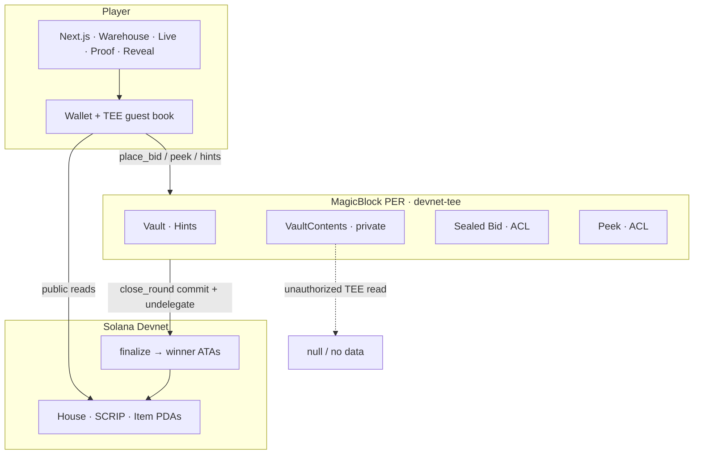
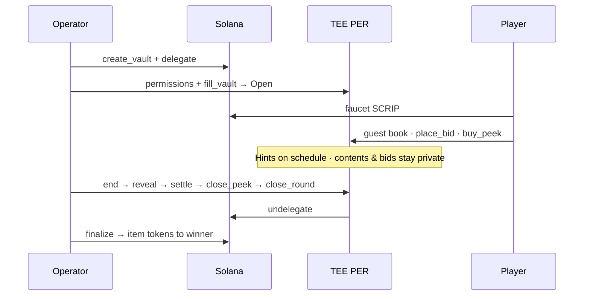

# Blind Vault

**Sealed creature-card auctions on Solana Devnet** — Storage Wars energy, MagicBlock Private Ephemeral Rollups under the hood.

Nobody (not even the house) can read what’s in the vault while it’s live. Hints drip on a schedule, bids stay sealed, paid peeks are private to the buyer, and the winner walks away with real Devnet SPL collectibles.

Built for **[Solana Blitz v10](https://luma.com/hedv5sgh)** · theme **Entertainment Finance**.

| | |
|--|--|
| **Live app** | [blind-vault-amber.vercel.app](https://blind-vault-amber.vercel.app) |
| **Repo** | [github.com/Aditya-linux/BlindVault](https://github.com/Aditya-linux/BlindVault) |
| **Submit** | [build.magicblock.app/?stage=blitz#submit](https://build.magicblock.app/?stage=blitz#submit) |

---

## The game in 30 seconds

1. **Paddle** — connect a Devnet wallet → sign the TEE guest book → claim free **SCRIP** (play credits, not real money).
2. **Live lot** — seal one bid; optionally buy a private peek (rarity + category only).
3. **Proof** — probe VaultContents / another wallet’s peek with honest TEE outcomes.
4. **Reveal** — vault opens; highest sealed bid wins the cards into their wallet after finalize.

**Judge moments we optimize for**

1. *I understand the game.*  
2. *I genuinely cannot see what the other player sees.*  
3. *That reveal was worth waiting for.*

---

## Why MagicBlock

Plain sealed-bid demos hide **amounts**. Blind Vault also hides the **lot**.

On a public chain, an RPC can read vault contents and bids as soon as they’re written. That’s fatal for a mystery auction. Private state lives on MagicBlock’s **Private Ephemeral Rollup** (`devnet-tee`): Intel TDX TEE + ephemeral permissions (ACLs). Different wallets get different eyes on the same accounts.

| Without PER | With Blind Vault + PER |
|-------------|------------------------|
| Contents visible on explorer | `VaultContents` private until reveal |
| Bids readable by anyone | Bid PDAs ACL’d to bidder (+ vault) |
| “Peek” is UI theater | Paid peek is a private account; stranger reads return no data |
| Hints hand-waved | Hints computed from private state on-chain |

**One-liner:** other MagicBlock auctions hide bids; we hide the box *and* the bids — and you can prove a stranger’s TEE read fails live.

---

## How we use MagicBlock

| Piece | Where | What it does here |
|-------|-------|-------------------|
| **Private Ephemeral Rollup** (`devnet-tee.magicblock.app`) | Vault, contents, hints, bids, peeks, pool | Private execution + private account reads |
| **Delegate / undelegate** | `delegate_vault` → `close_round` | Move accounts into the TEE, later commit home |
| **Ephemeral permissions (ACLs)** | contents / bid / peek | Buyer sees their peek; stranger gets no account data |
| **`getAuthToken` (TEE guest book)** | Paddle + scripts | Free signature unlocks authenticated TEE RPC |
| **Commit + undelegate** | `close_round` MagicIntent | Settlement path back to Solana for `finalize` |
| **SCRIP + item SPL** | Faucet, fees, custody | Public economy; privacy only where the game needs it |
| **Fill entropy** | `fill_vault` | **TEE-local mix today** — not ER VRF yet |

Client: `@magicblock-labs/ephemeral-rollups-sdk` · Program: Anchor **1.0.2** + ER SDK **0.16.x** (Rust).

---

## Architecture



### One lot lifecycle



---

## Features

| Area | What you get |
|------|----------------|
| **Warehouse** | 40 on-chain creature cards · Common → Legendary pull odds · browse without a wallet |
| **Paddle** | Guided setup, SOL/SCRIP balances, Devnet help, watch-without-wallet path |
| **Live arena** | Countdown, sealed-bid count, privacy-safe activity, one bid per wallet, paid peek |
| **Evidence / Proof** | Stamped txs · VaultContents probe · two-wallet peek proof (honest outcome classes) |
| **Reveal** | On-chain cards only · short open beat · skip/replay · settlement vs ownership copy |
| **My bids** | Sealed envelope + storage after finalize |
| **Keeper** | Hints → end → reveal → Model A settle → close → undelegate wait → finalize |

---

## Live Devnet

| | |
|--|--|
| Program | [`E9UmQYi4gTHyyQ3SK5B4UCpewBnUBFrEc5NqkkAjr42h`](https://explorer.solana.com/address/E9UmQYi4gTHyyQ3SK5B4UCpewBnUBFrEc5NqkkAjr42h?cluster=devnet) |
| House | `C7cfsQFawFQkNk6GsRk4LuCtRcUGAg1Ux7mp66EQDDFE` |
| SCRIP | `5RMEdwxEqfsdqiuSr658N4M5JFyTSeMC4KcF9b41bWHx` |
| TEE | `https://devnet-tee.magicblock.app` · validator `MTEWGuqxUpYZGFJQcp8tLN7x5v9BSeoFHYWQQ3n3xzo` |

**Sample evidence**

- Vault 8 full loop finalize: [`5uobPA…`](https://explorer.solana.com/tx/5uobPAb1N35TujTVvpthMJq3uShP1DJdnGCYUCgujNart5Lg6DQBN8GFkWisrf859t4mW43gvXzreuPQRt753yvP?cluster=devnet)
- Private peek (Vault 8 TEE): [`5DnHvB…`](https://explorer.solana.com/tx/5DnHvBaZT3dy71TM47vNch9Zx69cc8bfS8GtNMNA1ySf84HFAgwsgRXPQj1GraV4zgR4F4dKpFNMTUbfzxjZvkKV?cluster=devnet)

More stamps: [`data/exhibits.json`](data/exhibits.json) · status: [`docs/BUILD_STATUS.md`](docs/BUILD_STATUS.md) · 4-day ship: [`docs/SHIP_4DAY.md`](docs/SHIP_4DAY.md)

---

## Quick start

```bash
git clone https://github.com/Aditya-linux/BlindVault.git
cd BlindVault
cp .env.example app/.env.local   # fill Devnet RPC + program id
npm install --legacy-peer-deps
npm run typecheck
npm run dev
```

Open [http://localhost:3000](http://localhost:3000).

**Wallet:** Phantom/Solflare on **Devnet**, with a little Devnet SOL for fees. Claim SCRIP on **Paddle**.

### Deploy (Vercel)

- Install: `npm install --legacy-peer-deps --force`
- Build: `npm run build`
- Env: `NEXT_PUBLIC_SOLANA_RPC`, `NEXT_PUBLIC_TEE_RPC`, `NEXT_PUBLIC_TEE_WS`, `NEXT_PUBLIC_PROGRAM_ID`

### Operator scripts

```bash
npx tsx scripts/open-vault.ts --size 0
npx tsx scripts/keeper.ts --once          # hints → end → reveal → settle → finalize
npx tsx scripts/demo-bid.ts --amount 25
```

QA: [`docs/TEST_RUNBOOK.md`](docs/TEST_RUNBOOK.md)

---

## Repo map

| Path | Role |
|------|------|
| `programs/blind_vault` | Anchor program (PER + Solana settlement) |
| `app/` | Next.js UI — Rocco’s Lock-Up Auctions |
| `data/items.json` | Catalog + rarity tiers |
| `scripts/` | open / bid / peek / settle / keeper |
| `docs/` | BUILD_STATUS, SHIP_4DAY, TEST_RUNBOOK |

---

## Honest limits

- **Devnet / TEE only** — no mainnet, no real value. SCRIP is free play credit.
- **Fill** uses TEE-local entropy until ER VRF on `devnet-tee` is verified. We do **not** claim cryptographically verifiable randomness yet.
- **Privacy probes** are honest: a null TEE `getAccountInfo` is not labeled “ACCESS DENIED” alone — we check whether the public Vault still exists.
- **Loser refunds** require the losing bidder to sign; the keeper settles the winner and finalizes when peeks/bids are closed.
- Card art is original (TCG vibe) — not third-party IP.
- Privacy assumes MagicBlock’s attested TEE validator.

---

Built during Blitz week. Powered by MagicBlock Private Ephemeral Rollups.
