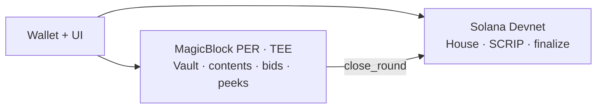

# Blind Vault

<p align="center">
  
</p>

<p align="center">
  <strong>Mystery creature-card auctions on Solana Devnet</strong><br/>
  Sealed lots · sealed bids · private peeks · MagicBlock PER (TEE)
</p>

<p align="center">
  <a href="https://blind-vault-amber.vercel.app"><strong>Live demo</strong></a> ·
  <a href="https://luma.com/hedv5sgh">Solana Blitz v10</a> ·
  <a href="https://build.magicblock.app/?stage=blitz#submit">Submit</a>
</p>

---

## What it is

Blind Vault is a **Storage Wars–style sealed auction** for collectible creature cards.

While a lot is live, **nobody** (not the house, not other bidders, not a public RPC) can read what’s inside. Hints drip on a schedule. Bids stay sealed. A paid peek is private to the buyer. When the clock ends, the vault opens and the highest sealed bid wins the cards.

**Judge checklist**

1. Browse the **Warehouse** with no wallet — see Common → Legendary cards.  
2. **Paddle** → connect Devnet wallet → TEE guest book → free **SCRIP**.  
3. **Live lot** → place one sealed bid (optional private peek).  
4. **Proof** → try reading private contents / another wallet’s peek (honest fail).  
5. **Reveal** → watch the lot open after the timer.

---

## Why MagicBlock

Most sealed-bid demos only hide **amounts**. We also hide the **box**.

| Without PER | With Blind Vault |
|-------------|------------------|
| Contents readable on explorer | `VaultContents` private until reveal |
| Bids public after write | Bid PDAs ACL’d to bidder |
| “Peek” is UI theater | Paid peek is a private account |
| Hints hand-waved | Hints from private on-chain state |

**One-liner:** hide the lot *and* the bids — and prove a stranger’s TEE read fails live.

| MagicBlock piece | Role here |
|------------------|-----------|
| Private ER (`devnet-tee`) | Private vault, contents, bids, peeks, hints |
| Delegate / undelegate | Move accounts into TEE → commit home for finalize |
| Ephemeral ACLs | Buyer sees peek; stranger gets no data |
| TEE guest book | One free signature → authenticated TEE RPC |

Fill uses **TEE-local entropy** today — not ER VRF yet (called out honestly in-app).

---

## Try it

| | |
|--|--|
| **App** | [blind-vault-amber.vercel.app](https://blind-vault-amber.vercel.app) |
| **Wallet** | Phantom / Solflare on **Devnet** + a little Devnet SOL |
| **Credits** | Claim free **SCRIP** on Paddle (play money, not real value) |

```bash
git clone https://github.com/Aditya-linux/BlindVault.git
cd BlindVault
cp .env.example app/.env.local   # Devnet RPC + program id
npm install --legacy-peer-deps
npm run dev
```

→ [http://localhost:3000](http://localhost:3000)

---

## Architecture



**Lot loop:** open → hints → end → reveal → settle → close → finalize → next.

---

## Live Devnet

| | |
|--|--|
| Program | [`E9UmQYi…jr42h`](https://explorer.solana.com/address/E9UmQYi4gTHyyQ3SK5B4UCpewBnUBFrEc5NqkkAjr42h?cluster=devnet) |
| House | `C7cfsQFawFQkNk6GsRk4LuCtRcUGAg1Ux7mp66EQDDFE` |
| SCRIP | `5RMEdwxEqfsdqiuSr658N4M5JFyTSeMC4KcF9b41bWHx` |
| TEE | `https://devnet-tee.magicblock.app` |

Evidence stamps: [`data/exhibits.json`](data/exhibits.json) · status: [`docs/BUILD_STATUS.md`](docs/BUILD_STATUS.md)

---

## Repo

| Path | Role |
|------|------|
| `app/` | Next.js UI + brand (`public/brand/`) |
| `programs/blind_vault` | Anchor program (PER + settlement) |
| `scripts/` | open-vault · keeper · auto-round · demo-bid |
| `docs/` | build status, ship plan, test runbook |
| `data/` | catalog + exhibits |

```bash
npx tsx scripts/open-vault.ts --size 0
npx tsx scripts/keeper.ts --once
npx tsx scripts/auto-round.ts
```

**Vercel:** install `npm install --legacy-peer-deps --force` · build `npm run build` · env `NEXT_PUBLIC_SOLANA_RPC`, `NEXT_PUBLIC_TEE_RPC`, `NEXT_PUBLIC_TEE_WS`, `NEXT_PUBLIC_PROGRAM_ID`

---

## Honest limits

- **Devnet / TEE only** — no mainnet, no real funds. SCRIP is free play credit.
- Fill entropy is TEE-local until ER VRF on TEE is verified — we don’t fake VRF.
- Loser refunds need the losing bidder’s signature; keeper settles the winner path.
- Privacy assumes MagicBlock’s attested TEE validator.

---

Built for **Solana Blitz v10 · Entertainment Finance**. Powered by MagicBlock Private Ephemeral Rollups.
