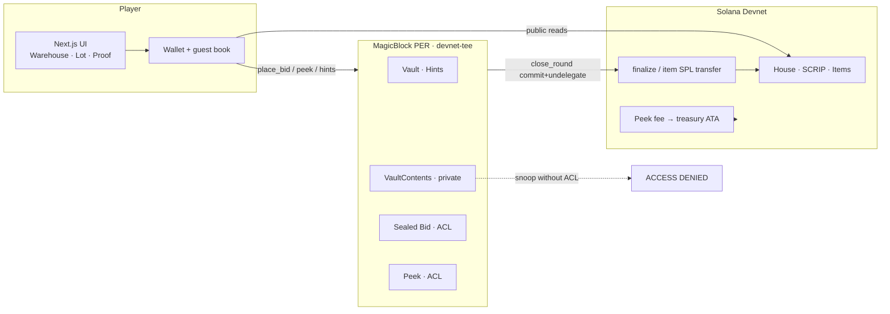
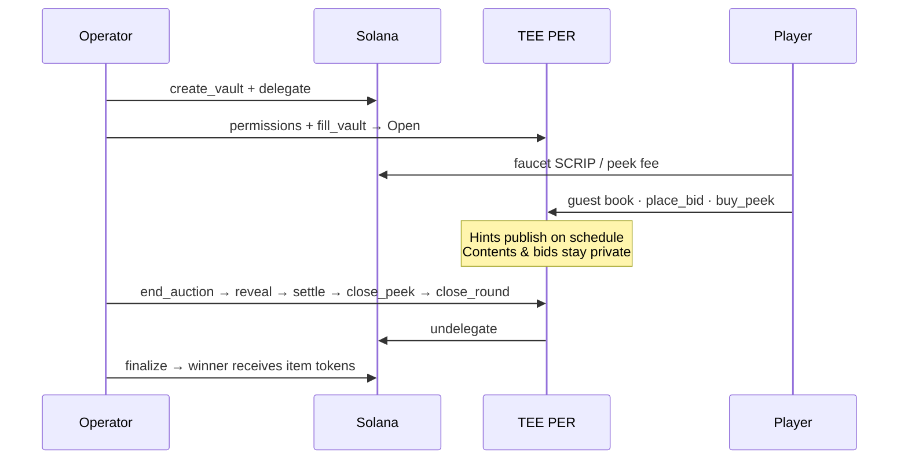

# Blind Vault

Sealed storage-unit auctions on Solana Devnet — **Storage Wars** energy, MagicBlock privacy under the hood.

Nobody (not even the house) can read what’s in the vault while it’s live. Hints drip out on a schedule, bids stay sealed, paid peeks are private to the buyer, and the winner walks away with real SPL collectibles.

Built for **[Solana Blitz v10](https://luma.com/hedv5sgh)** by MagicBlock — theme: **Entertainment Finance** (trade, collect, compete, win assets you own).

**Repo:** [github.com/Aditya-linux/BlindVault](https://github.com/Aditya-linux/BlindVault)  
**Submit:** [build.magicblock.app/?stage=blitz#submit](https://build.magicblock.app/?stage=blitz#submit)

---

## Why MagicBlock (not “Solana + vibes”)

Plain sealed-bid demos already hide **amounts**. Blind Vault also hides the **lot**.

On a public chain, an RPC can read vault contents and bids the moment they’re written. That’s fine for many apps — it’s fatal for a mystery auction. So the private state lives on MagicBlock’s **Private Ephemeral Rollup** (`devnet-tee`): Intel TDX TEE + ephemeral permissions (ACLs). Different wallets literally get different eyes on the same accounts.

| Without PER | With Blind Vault + PER |
|-------------|-------------------------|
| Contents visible on explorer | `VaultContents` private until reveal |
| Bids readable by anyone | Bid PDAs ACL’d to bidder (+ vault) |
| “Peek” is just UI theater | Paid peek is a private account; snoop → ACCESS DENIED |
| Hints could be hand-waved | Hints computed from private state on-chain |

**One-liner for judges:** other MagicBlock auctions hide bids; we hide the box *and* the bids — and you can prove the snoop fails live.

---

## How we use the MagicBlock stack

Concrete pieces from MagicBlock docs / ER SDK — not a checklist of buzzwords.

| Piece | Where it shows up | What it does here |
|-------|-------------------|-------------------|
| **Private Ephemeral Rollup** (`devnet-tee.magicblock.app`) | Vault, contents, hints, bids, peeks, pool ledger | Private execution + private account reads |
| **Delegate / undelegate** | `delegate_vault`, `delegate_contents`, … → `close_round` | Move accounts into the TEE, later commit + bring them home |
| **Ephemeral permissions (ACLs)** | `init_contents_permission`, `init_bid_permission`, peek ACL | “Different eyes” — buyer sees their peek; stranger gets denied |
| **`getAuthToken` (TEE guest book)** | App paddle + scripts | Free signature unlocks authenticated TEE RPC |
| **Commit + undelegate** | `close_round` MagicIntent bundle | Settlement path back to Solana for `finalize` |
| **SCRIP + item SPL on Solana** | Faucet, treasury fee, item custody | Public economy; privacy only where the game needs it |
| **Fill entropy** | `fill_vault` | TEE-local mix today; **ER VRF** is the honest next step once verified on TEE (we don’t fake VRF success) |

App client: `@magicblock-labs/ephemeral-rollups-sdk` · program: Anchor **1.0.2** + ER SDK **0.16.x** (Rust), pinned to stay compatible with MagicBlock templates.

---

## Architecture



### Lifecycle (one lot)



---

## Player loop

1. **Warehouse** — 40 on-chain items (no wallet required)
2. **Paddle** — connect → sign TEE guest book → claim SCRIP
3. **Live lot** — timed hints → seal a bid → optional paid peek
4. **Proof** — try to snoop contents / someone else’s peek → denied until reveal
5. **Reveal** — lot opens; winner’s items show in **Me** / warehouse sold tags

---

## Live Devnet

| | |
|--|--|
| Program | [`E9UmQYi4gTHyyQ3SK5B4UCpewBnUBFrEc5NqkkAjr42h`](https://explorer.solana.com/address/E9UmQYi4gTHyyQ3SK5B4UCpewBnUBFrEc5NqkkAjr42h?cluster=devnet) |
| House | `C7cfsQFawFQkNk6GsRk4LuCtRcUGAg1Ux7mp66EQDDFE` |
| SCRIP | `5RMEdwxEqfsdqiuSr658N4M5JFyTSeMC4KcF9b41bWHx` |
| TEE | `https://devnet-tee.magicblock.app` · validator `MTEWGuqxUpYZGFJQcp8tLN7x5v9BSeoFHYWQQ3n3xzo` |

**Sample evidence**

- Full settle (Vault 5 finalize): [`5Nun4q…`](https://explorer.solana.com/tx/5Nun4qFDYFgv2EQ3Cca7kLz9KRfpFEF96dUTxV8oPMSdUTpHvUcWKLNVVLNzLYtrickVKofjCBuQTHHQWGZFQL8C?cluster=devnet)
- Private peek (Vault 8 TEE): [`5DnHvB…`](https://explorer.solana.com/tx/5DnHvBaZT3dy71TM47vNch9Zx69cc8bfS8GtNMNA1ySf84HFAgwsgRXPQj1GraV4zgR4F4dKpFNMTUbfzxjZvkKV?cluster=devnet)
- Vault 8 finalize: [`5uobPA…`](https://explorer.solana.com/tx/5uobPAb1N35TujTVvpthMJq3uShP1DJdnGCYUCgujNart5Lg6DQBN8GFkWisrf859t4mW43gvXzreuPQRt753yvP?cluster=devnet)

More stamps: [`data/exhibits.json`](data/exhibits.json) · status board: [`docs/BUILD_STATUS.md`](docs/BUILD_STATUS.md)

---

## Quick start

```bash
git clone https://github.com/Aditya-linux/BlindVault.git
cd BlindVault
cp .env.example app/.env.local   # optional: set a Devnet RPC
npm install --legacy-peer-deps
npm run typecheck
npm run dev                      # http://localhost:3000
```

Operator (funded Devnet key as `ANCHOR_WALLET`):

```bash
npx tsx scripts/open-vault.ts --size 0
npx tsx scripts/demo-bid.ts --amount 25
npx tsx scripts/debug/_buy-peek.ts
npx tsx scripts/debug/_verify-peek.ts   # expect ACCESS DENIED without token
# after deadline
npx tsx scripts/debug/_finish-v8-settle.ts
```

Step-by-step QA: **[`docs/TEST_RUNBOOK.md`](docs/TEST_RUNBOOK.md)**  
Blitz form draft: **[`docs/BLITZ_FORM_DRAFT.md`](docs/BLITZ_FORM_DRAFT.md)**

---

## Repo map

| Path | Role |
|------|------|
| `programs/blind_vault` | Anchor program (PER + Solana settlement) |
| `app/` | Next.js — Rocco’s Lock-Up Auctions |
| `data/items.json` + `app/public/items/` | Catalog + art |
| `scripts/` | open / bid / peek / settle / keeper |
| `docs/` | status, checklist, test runbook |

---

## Honest limits

- **Devnet / TEE only** — no mainnet, no real value.
- **Fill** uses TEE-local entropy until ER VRF on `devnet-tee` is verified. We document that; we don’t count a mock as VRF proof.
- Privacy assumes MagicBlock’s attested TEE validator (same trust model as PER itself).

---

Built during Blitz week. Powered by MagicBlock Private Ephemeral Rollups.
